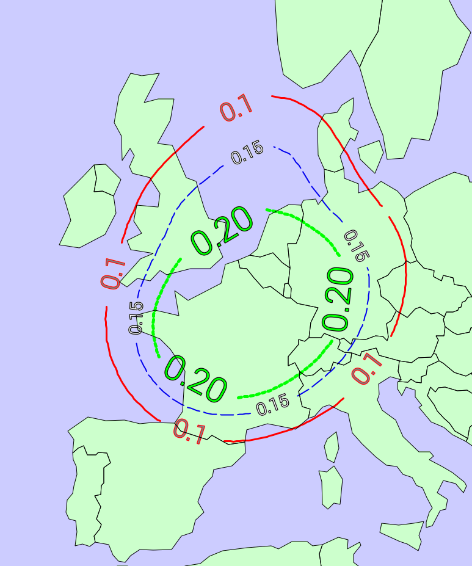
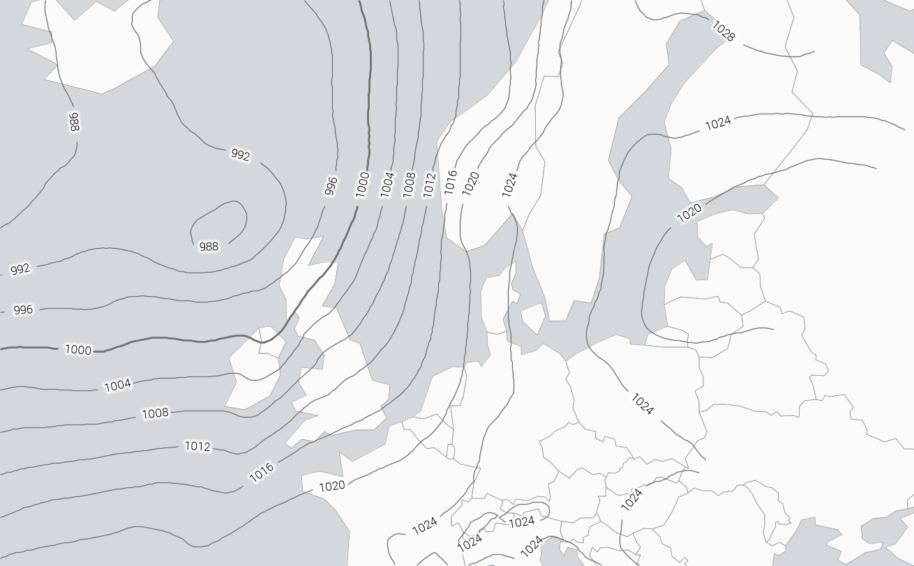

ContourLine (width,linecolor,textcolor,textformatting,interval,classes)
=======================================================================

Back to [Configuration](./Configuration.md)

-   width - The width of the line
-   linecolor - The color of the line in hexadecimal format #RRGGBB
-   textcolor - The color of the text in hexadecimal format #RRGGBB
-   dashing - The dashing of the line. Comma separated list of values like "10,5"
-   textstrokecolor - The outline color of the text in hexadecimal format #RRGGBB. Leave unset
    (or fully transparent, e.g. #00000000) for plain text with no outline.
-   textstrokewidth - Width in pixels of the text outline (default 0.75). Only has an effect when
    textstrokecolor is set.
-   textsofthalo - "true" or "false" (default "false"). When "true", the text outline is drawn as
    a soft, blurred-looking halo (several graduated passes) instead of a single crisp stroke -
    closer to the label style on a typical synoptic weather chart. Only has an effect when
    textstrokecolor is set.
-   textsize - Fontsize in pixels (e.g. 15)
-   textformatting - How the text is displayed, using standard string
    formatting. Use "" for no text in contourlines
-   textdistance - Spacing in pixels between repeated labels along one traced line (default 60).
    Lower values label a line more densely, higher values more sparsely - a long line can still
    get more than one label even at a high textdistance.
-   textgap - "true" or "false" (default "true"). When "true" (the default), the line leaves an
    actual gap wherever it passes under a label - its own or another contour definition's. When
    "false", the line is drawn straight through instead; combine with a wide, opaque
    textstrokecolor/textstrokewidth (and textsofthalo="true") so the label's own background still
    visually hides the line underneath it, rather than the line showing through the text.
-   interval - Draw lines at every <n> value
-   classes - Comma separated list of values to draw lines on.
-   boldvalues - Comma separated list of binned values (e.g. "1000") to draw at boldwidth instead
    of width - e.g. to emphasize the 1000 hPa isobar on a pressure chart, the way many synoptic
    charts do. Only has an effect when boldwidth is also set.
-   boldwidth - The line width used for the values listed in boldvalues.

Draw Contourline at every degree:

```xml
<ContourLine width="0.3" linecolor="#444444" textcolor="#444444" textformatting="%2.0f" interval="1"/>
```

Draw Contourline at defined values:

```xml
<ContourLine width="0.3" linecolor="#444444" textcolor="#444444" textformatting="%2.0f" classes="10,25,50,100,150"/>
```


## Draw dashed contourlines:

```xml
<?xml version="1.0" encoding="UTF-8" ?>
<Configuration>

    <Settings cache_age_volatileresources="60" cache_age_cacheableresources="7200" />

    <Style name="testdata_style_manycontours">
        <ContourLine width="2" linecolor="#0000EE" textcolor="#FFFFFF" textstrokecolor="#000000" textsize="20.0" textformatting="%2.2f" classes="0.15" dashing="21,7"/>
        <ContourLine width="3" linecolor="#FF0000" textcolor="#808080" textstrokecolor="#FF0000" textsize="30.0" textformatting="%2.1f" classes="0.10"/>
        <ContourLine width="5" linecolor="#00FF00" textcolor="#00FF00" textstrokecolor="#000000" textsize="40.0" textformatting="%2.2f" classes="0.20" dashing="5,5"/>
        <RenderMethod>contour</RenderMethod>
    </Style>

    <!-- Layers -->

    <Layer type="database">
        <Name>dashed_contour_lines</Name>
        <FilePath filter="">{ADAGUC_PATH}data/datasets/testdata.nc</FilePath>
        <Title>Dashed contourlines</Title>
        <Variable>testdata</Variable>
        <Styles>testdata_style_manycontours</Styles>
    </Layer>

    <!-- End of configuration /-->
</Configuration>
```


Will give:




## Draw synoptic weather chart style isobars (gap-free lines, soft label halo, bold reference line):

```xml
<ContourLine width="1.3" linecolor="#707070" textcolor="#000000" textstrokecolor="#FFFFFF"
             textstrokewidth="4" textsize="12" textformatting="%2.0f" interval="4"
             textdistance="100" textgap="false" textsofthalo="true"
             boldvalues="1000" boldwidth="2.8"/>
```

Will give:



See the [tutorial on configuring synoptic-chart style contourlines](../tutorials/Configuring_synoptic_style_contourlines.md) for a full walkthrough of this example, including the land/sea base map layers.

