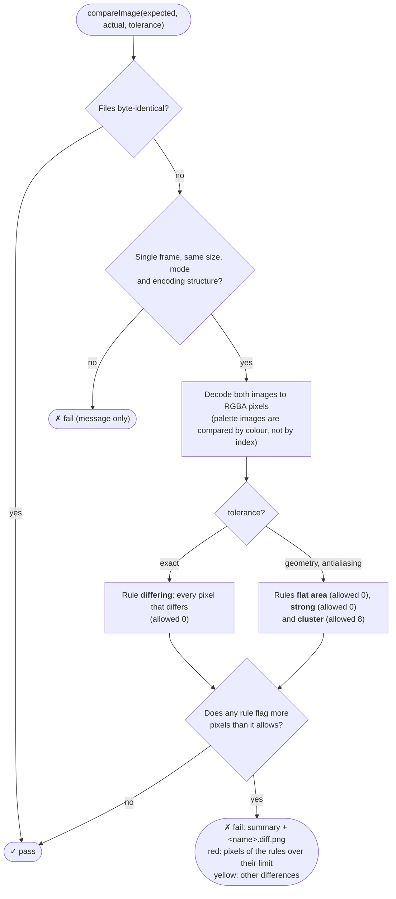
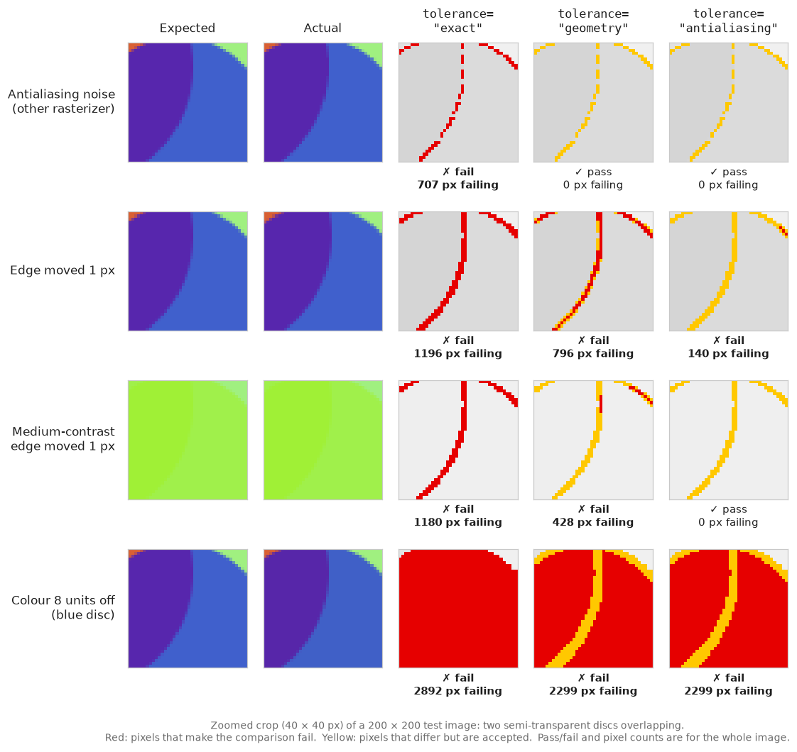
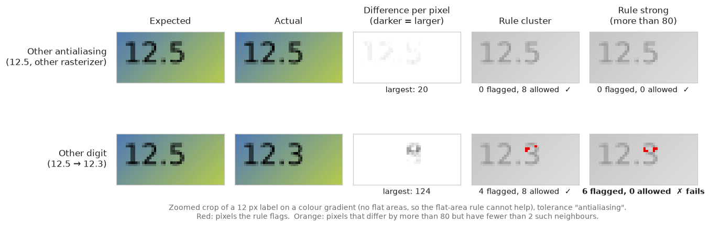

# Antialiasing differences between environments

`CDrawImage` renders through [Cairo](https://www.cairographics.org/) - circles, polygons, lines and text all go through Cairo's own path-filling and antialiasing (`cairo_arc`, `cairo_fill`, `cairo_stroke`, and Cairo's FreeType-backed text rendering). Cairo delegates the actual pixel-coverage computation for antialiasing to [pixman](http://pixman.org/). Neither library's output is part of any stability guarantee across versions: pixman's rasterizer has had coverage-computation changes between minor releases, and different Linux distributions (and even different point releases of the same distribution) ship different pixman/cairo versions.

Text has a third source of differences: the glyphs are rasterized by [FreeType](https://freetype.org/), whose hinting and antialiasing also change between versions. For example, Homebrew on macOS ships FreeType 2.15, while the Debian trixie base of the Docker image has 2.13, and almost every image with text then differs at the glyph edges.

In practice this means: **the same adaguc-server source code, compiled on two machines with different cairo/pixman versions, can produce a handful of pixels that differ by a few color units at shape edges** - even though the drawing calls, coordinates and colors are bit-for-bit identical. Flat, unambiguous fill regions are unaffected; only pixels where coverage is fractional (an antialiased edge, a clipped shape boundary, two semi-transparent shapes overlapping right at their edge) are sensitive to this.

## Why this matters now

Before the Cairo integration, `CDrawImage`'s shape-drawing primitives were first-party, dependency-free code - deterministic across any machine that compiles it, regardless of installed libraries. That's no longer true for the parts that now go through Cairo. This is an accepted tradeoff of using Cairo (correctness, maintainability, feature set), not a regression to chase down line-by-line.

## What it looks like in a test failure

A real, concrete example: a WMS GetMap test rendering several semi-transparent, partially canvas-clipped marker shapes failed in a Docker build but passed identically, byte-for-byte matching the golden image, on a local build of the exact same commit.

```
my local machine:   cairo 1.18.0, pixman 0.42.2
docker image:        cairo 1.18.4, pixman 0.44.0
```

The diff was 73 pixels out of ~1,000,000 (0.007%), concentrated at:

- the top tangent of each circle (where the rasterizer's fractional coverage is most sensitive to sub-pixel position),
- the one marker additionally clipped by the canvas edge (clipping combined with antialiasing compounds the sensitivity).

Every other pixel - including the interior of every filled shape, and every shape not touching an edge or another shape - matched exactly.

### How to tell this apart from a real rendering bug

Before assuming a color-difference test failure is this kind of environment noise, check:

1. **Does the diff reproduce on a clean local build of the same commit?** If a local (non-Docker) build matches the golden image exactly, and only a Docker (or otherwise differently-toolchained) build differs, that's a strong signal it's library-version noise, not a logic bug. On macOS with Homebrew libraries, a local build does not match the golden images exactly, even with the same library versions (see [Other causes](#other-causes-how-the-libraries-are-built-and-numerical-instability)); compare with the output of the same commit on `master` instead.
2. **Is the difference small and localized?** A handful of pixels, each off by single-digit-to-low-double-digit color units, located at shape edges/overlaps/clipping boundaries, fits this pattern. Large shifts, shifted positions, wrong colors in the interior of a shape, or differences affecting a large fraction of the image point to an actual bug instead.
3. **Does `git diff` against `master` show the relevant drawing code as unchanged?** If the exact primitive producing the differing pixels is untouched, the cause is external (library version), not something to fix in that code.
4. **Do some symbols differ as a whole, while all others match exactly?** If a few barbs, vectors or labels are moved or rotated, but not their neighbours, look for a numerical instability in adaguc (a sign or rounding decision on a value close to zero, for example) instead of antialiasing. The diff image shows this clearly: whole shapes in red, instead of scattered edge pixels.

## Other causes: how the libraries are built, and numerical instability

Library versions are not the only cause. Two more were found by comparing a macOS build (Apple clang, Homebrew libraries) with Linux builds (GCC) of the same commit, all on ARM64:

- **The same library versions, built by a different compiler.** With the same pixman version on both, contour lines and outlined wind barbs still differed along their whole length, by fractions of a pixel. Switching cairo on macOS between 1.18.4 and 1.18.6 gave pixel-identical output, switching pixman's NEON and fast paths did not reproduce it, and perturbing every libm result by one unit in the last place (which also covers PROJ) changed nothing in these images. What remains is the floating-point arithmetic inside the libraries themselves, such as cairo's stroker, which a different compiler rounds or fuses differently. Text adds FreeType on top.
- **Numerical instability in adaguc itself.** Before the fix in [#824](https://github.com/KNMI/adaguc-server/pull/824), the rotation of grid-relative wind decided the sign of a small angle (half a grid cell's arc, 0.115 degree on the 0.23 degree test grid) from a value of about 1e-15, which is pure rounding noise. The last-bit differences between Apple's libm and glibc then flipped the sign for some grid points, so 13 of 428 wind barbs were rotated by about 0.23 degree on macOS. That is not antialiasing noise but a bug, and it was fixed in the code.

The build already avoids one source of differences: on ARM64, `CMakeLists.txt` compiles with `-ffp-contract=off`, so the compiler does not fuse multiplications and additions into FMA instructions, which x86-64 builds do not use by default either.

## Handling it in tests

`AdagucTestTools.compareImage(expected, actual, tolerance=...)` (implemented in `python/lib/adaguc/imagecompare.py`, also available as `conftest.run_adaguc_and_compare_image(..., tolerance=...)`) has three tolerances, from strict to loose:

| `tolerance` | Use for |
|---|---|
| `"exact"` (default) | Images without antialiasing: raster output only (nearest, bilinear, shaded), no lines, symbols or text. |
| `"geometry"` | Images with antialiased lines or shapes (contours, barbs, vectors, polylines, discs), but no text. Detects every shift of one pixel. |
| `"antialiasing"` | Images with text: legends, labels, titles, dimension and value text. |

**Choose the tolerance by what the image contains, not by what happens to pass today.** Text is rasterized by FreeType, lines and shapes by pixman, and both change between versions. An image with text can be byte-identical in all environments we test in (many are) and still break with the next FreeType release, so it gets `"antialiasing"`. The exception is a test that is about positions (reprojection, grid alignment, picking points from a grid): it may use `"geometry"` even with some text, accepting that a FreeType update may require loosening it.

The tolerances in the tests were chosen that way, by recording which cairo calls (text, antialiased fills and strokes) each request makes, and then checked in three environments: a local Linux build, the Docker image (Debian: cairo 1.18.4, pixman 0.44.0, FreeType 2.13.3) and macOS with Homebrew (cairo 1.18.6, pixman 0.46.4, FreeType 2.15.0). Where the content allows a stricter tolerance than passes in all three, the looser one is used.

Don't loosen a comparison reflexively to make a failure go away - confirm it against the checklist above first.

### How a comparison works

First, both images must have a single frame, the same size, the same image mode and the same encoding structure (see [Encoding and file size](#encoding-and-file-size)). Then both are decoded to RGBA pixels, and the tolerance applies its rules. The *difference* of a pixel is the largest difference over its red, green, blue and alpha values, compared with the same pixel in the other image (0 to 255). **Each rule flags pixels and allows a number of them. The images match if no rule flags more pixels than it allows.**

| Rule | Tolerances | A pixel is flagged when | Allowed |
|---|---|---|---|
| differing | `"exact"` | it differs at all | 0 |
| flat area | `"geometry"`, `"antialiasing"` | its 3x3 neighbourhood is flat (colour range at most 4) in either image, and it differs by more than 2 | 0 |
| strong | `"geometry"`, `"antialiasing"` | it differs by more than 80, and at least 2 of its 8 neighbours do too | 0 |
| cluster | `"geometry"`, `"antialiasing"` | it is *off* by more than 16, and at least 2 of its 8 neighbours are too | 8 |

The two loose tolerances only differ in what *off* means:

- `"geometry"`: the pixel is compared with the same pixel in the other image.
- `"antialiasing"`: the pixel is compared with the colour range of the 3x3 neighbourhood around the same pixel in the other image, in both directions. At an edge that range holds the colours of both sides, so a different antialiasing coverage is accepted.

Why each rule: antialiasing differences only occur at edges, they are limited in size, and they are scattered. A real rendering change breaks at least one of these:

- **flat area**: antialiasing never changes a pixel in a flat area. This rule catches small colour changes (a slightly different palette, a seam between triangles that is blended twice) and small shapes on a plain background, down to a single pixel.
- **strong**: antialiasing differences are partial changes of the coverage of edge pixels. Between the Docker image and macOS, text pixels differed by at most 86, other pixels by at most 142, and never two neighbouring pixels both by more than 80. A real change, such as another digit, turns whole pixels of a stroke from background into text colour, so neighbouring pixels change by nearly the contrast between text and background. See [Why `"antialiasing"` needs the strong rule](#why-antialiasing-needs-the-strong-rule).
- **cluster**: catches larger changes of moderate size near edges, such as a shift of a line or a missing shape.

The limit of 8 pixels does not grow with the image size. It stands for the smallest real change that must be detected, and a missing symbol or digit is not larger on a larger map. The antialiasing noise does not grow with the image size either: it depends on the amount of text and edges. The comparison is symmetric: swapping expected and actual gives the same result.



Rendered image: [image-compare-flow.svg](./image-compare-flow.svg) ([PNG](./image-compare-flow.png))

Known limitations of the loose tolerances:

- `"antialiasing"` accepts an edge with a contrast below 80 that moves by **1 pixel or less**: its new colour already occurs in the neighbourhood, so it looks the same as an antialiasing difference. `"geometry"` detects it.
- Both accept a change of a few pixels right next to an edge or text, by less than 80. For example a 2x2 dot in a similar colour drawn on a line, or a 1 pixel wide line shorter than about 10 pixels along an edge.
- Not every change in small text is detected; see the detection rates below.

What each tolerance does with four kinds of differences, computed with the real comparison on a synthetic test image (two overlapping, semi-transparent discs). Antialiasing noise only fails `"exact"`. An edge moved by one pixel fails all three, unless its contrast is lower than 80: then it passes `"antialiasing"`. A small colour change fails all three:



The figure is generated by [figures/image_compare_tolerances.py](./figures/image_compare_tolerances.py). Regenerate it after changing `imagecompare.py`: `python doc/developing/figures/image_compare_tolerances.py` from the repository root (needs matplotlib: `pip install matplotlib`).

### Why `"antialiasing"` needs the strong rule

In a small label the strokes are 1 or 2 pixels wide and close together, so the 3x3 neighbourhood of almost every pixel in the text holds both the text and the background colour. Whatever another digit draws there lies within that colour range, so for the cluster rule of `"antialiasing"` it looks like an antialiasing difference. In the figure below, the cluster rule flags only 4 pixels when "12.5" becomes "12.3", fewer than the 8 it allows.

The strong rule looks at the difference itself instead. Other antialiasing changes the coverage of edge pixels a little (here by at most 20). Another digit changes whole stroke pixels, by up to the contrast between text and background (here 124), and those pixels lie next to each other along the stroke. The strong rule flags a pixel if its difference is more than 80 and at least 2 of its 8 neighbours also differ by more than 80, and it allows none:



The figure is generated by [figures/image_compare_strong_rule.py](./figures/image_compare_strong_rule.py), in the same way as the one above.

How many changes in text are detected, measured with FreeSans labels at 16 sub-pixel positions on three backgrounds (plain, random texture and a darker colour gradient; the last two have no flat areas). adagucserver draws text at `fontsize` × 100/72 pixels, so the common `fontsize="8"` is about 11 px and `fontsize="10"` about 14 px:

| Text size | One digit changed (90 pairs) | One letter, or a unit or word ("hPa" → "kPa", "°C" → "°F", ...) |
|---|---|---|
| 8 px (`fontsize="6"`) | 76 - 94 % | 80 - 96 % |
| 11 px (`fontsize="8"`) | 97 - 99.7 % | 89 - 100 % |
| 14 px and larger | 100 % | 99.7 - 100 % |

The missed changes are pairs that differ by one small stroke, such as 6 ↔ 8 and 8 ↔ 9 at 11 px, f → t, r → t and "Temp" → "Tamp". Which ones are missed also depends on where the glyphs fall on the pixel grid. Characters that look almost the same in the font, such as I and l, or `.` and `,` in small text, are often not detected at all. Text with a low contrast against its background, below about 80, is a blind spot of the strong rule. `TestImageCompare.py` checks these rates for 11, 14 and 18 px.

When a comparison fails, the test prints the number of flagged pixels per rule and writes a diff image next to the actual output in `tests/testresults/` (`<name>.diff.png`): the actual image faded to grey, the pixels of the rules over their limit in red, and the other differences in yellow. Use it to check items 2 and 3 of the checklist.

### Encoding and file size

Besides the pixels, `compareImage` compares the encoding structure: for PNG the bit depth, colour type, interlacing and the sequence of chunks (for example `PLTE tRNS IDAT IEND` for a palette image), for WebP the chunks (`VP8X`, `ALPH`, `VP8`, `VP8L`, ...). That catches a change in how adagucserver calls the encoders, such as an extra metadata chunk or lossy instead of lossless WebP. The compression itself is checked in one test per output format (palette PNG, RGB PNG, RGBA PNG and WebP) with `AdagucTestTools.compareFileSizes`: the file may be at most 1.5 times as large as the expected one.

Don't compare images byte for byte (`data == readfromfile(...)`, `run_adaguc_and_compare_file`). The bytes also depend on the zlib, libpng and libwebp versions (zlib or zlib-ng, the order of the palette), so such a test fails after a library update while the image is the same. Use `compareImage` with `"exact"` instead.
