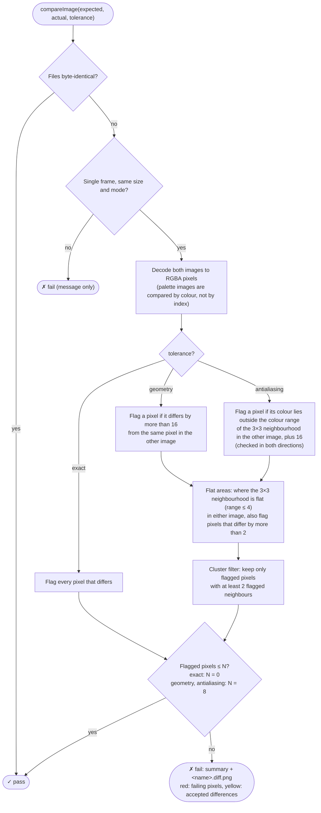

# Antialiasing differences between environments

`CDrawImage` renders through [Cairo](https://www.cairographics.org/) - circles, polygons, lines and text all go through Cairo's own path-filling and antialiasing (`cairo_arc`, `cairo_fill`, `cairo_stroke`, and Cairo's FreeType-backed text rendering). Cairo delegates the actual pixel-coverage computation for antialiasing to [pixman](http://pixman.org/). Neither library's output is part of any stability guarantee across versions: pixman's rasterizer has had coverage-computation changes between minor releases, and different Linux distributions (and even different point releases of the same distribution) ship different pixman/cairo versions.

Text has a third source of differences: the glyphs are rasterized by [FreeType](https://freetype.org/), whose hinting and antialiasing also change between versions. For example, Homebrew on macOS ships FreeType 2.15, while the Debian trixie base of the Docker image has 2.13, and almost every image with text then differs at the glyph edges.

In practice this means: **the same adaguc-server source code, compiled on two machines with different cairo/pixman versions, can produce a handful of pixels that differ by a few color units at shape edges** - even though the drawing calls, coordinates and colors are bit-for-bit identical. Flat, unambiguous fill regions are unaffected; only pixels where coverage is fractional (an antialiased edge, a clipped shape boundary, two semi-transparent shapes overlapping right at their edge) are sensitive to this.

## Why this matters now

Before the Cairo integration, `CDrawImage`'s shape-drawing primitives were first-party, dependency-free code - deterministic across any machine that compiles it, regardless of installed libraries. That's no longer true for the parts that now go through Cairo. This is an accepted tradeoff of using Cairo (correctness, maintainability, feature set), not a regression to chase down line-by-line.

## What it looks like in a test failure

A real, concrete example: a WMS GetMap test rendering several semi-transparent, partially canvas-clipped marker shapes failed in a Docker build but passed identically, byte-for-byte matching the golden image, on a local build of the exact same commit.

```
my local machine:   cairo 1.18.0, pixman 0.42.2
docker image:        cairo 1.18.4, pixman 0.44.0
```

The diff was 73 pixels out of ~1,000,000 (0.007%), concentrated at:

- the top tangent of each circle (where the rasterizer's fractional coverage is most sensitive to sub-pixel position),
- the one marker additionally clipped by the canvas edge (clipping combined with antialiasing compounds the sensitivity).

Every other pixel - including the interior of every filled shape, and every shape not touching an edge or another shape - matched exactly.

### How to tell this apart from a real rendering bug

Before assuming a color-difference test failure is this kind of environment noise, check:

1. **Does the diff reproduce on a clean local build of the same commit?** If a local (non-Docker) build matches the golden image exactly, and only a Docker (or otherwise differently-toolchained) build differs, that's a strong signal it's library-version noise, not a logic bug. On macOS with Homebrew libraries, a local build does not match the golden images exactly, even with the same library versions (see [Other causes](#other-causes-how-the-libraries-are-built-and-numerical-instability)); compare with the output of the same commit on `master` instead.
2. **Is the difference small and localized?** A handful of pixels, each off by single-digit-to-low-double-digit color units, located at shape edges/overlaps/clipping boundaries, fits this pattern. Large shifts, shifted positions, wrong colors in the interior of a shape, or differences affecting a large fraction of the image point to an actual bug instead.
3. **Does `git diff` against `master` show the relevant drawing code as unchanged?** If the exact primitive producing the differing pixels is untouched, the cause is external (library version), not something to fix in that code.
4. **Do some symbols differ as a whole, while all others match exactly?** If a few barbs, vectors or labels are moved or rotated, but not their neighbours, look for a numerical instability in adaguc (a sign or rounding decision on a value close to zero, for example) instead of antialiasing. The diff image shows this clearly: whole shapes in red, instead of scattered edge pixels.

## Other causes: how the libraries are built, and numerical instability

Library versions are not the only cause. Two more were found by comparing a macOS build (Apple clang, Homebrew libraries) with Linux builds (GCC) of the same commit, all on ARM64:

- **The same library versions, built by a different compiler.** With the same pixman version on both, contour lines and outlined wind barbs still differed along their whole length, by fractions of a pixel. Switching cairo on macOS between 1.18.4 and 1.18.6 gave pixel-identical output, switching pixman's NEON and fast paths did not reproduce it, and perturbing every libm result by one unit in the last place (which also covers PROJ) changed nothing in these images. What remains is the floating-point arithmetic inside the libraries themselves, such as cairo's stroker, which a different compiler rounds or fuses differently. Text adds FreeType on top.
- **Numerical instability in adaguc itself.** Before the fix in [#824](https://github.com/KNMI/adaguc-server/pull/824), the rotation of grid-relative wind decided the sign of a small angle (half a grid cell's arc, 0.115 degree on the 0.23 degree test grid) from a value of about 1e-15, which is pure rounding noise. The last-bit differences between Apple's libm and glibc then flipped the sign for some grid points, so 13 of 428 wind barbs were rotated by about 0.23 degree on macOS. That is not antialiasing noise but a bug, and it was fixed in the code.

The build already avoids one source of differences: on ARM64, `CMakeLists.txt` compiles with `-ffp-contract=off`, so the compiler does not fuse multiplications and additions into FMA instructions, which x86-64 builds do not use by default either.

## Handling it in tests

`AdagucTestTools.compareImage(expected, actual, tolerance=...)` (implemented in `python/lib/adaguc/imagecompare.py`, also available as `conftest.run_adaguc_and_compare_image(..., tolerance=...)`) has three tolerances, from strict to loose:

| `tolerance` | What must match | Use for |
|---|---|---|
| `"exact"` (default) | Every pixel, after converting both images to RGBA. | Images without antialiasing: raster output only (nearest, bilinear, shaded), no lines, symbols or text. |
| `"geometry"` | Each pixel within 16 colour units of the same pixel in the other image (2 in flat areas, see below). | Images with antialiased lines or shapes (contours, barbs, vectors, polylines, discs), but no text. Still detects a shift of one pixel. |
| `"antialiasing"` | Each pixel within the colour range of the 3x3 neighbourhood of the same pixel in the other image, plus 16 colour units (2 in flat areas). | Images with text: legends, labels, titles, dimension and value text. |

For all tolerances, the size and the image mode must match. Animated images (more than one frame) are not supported, because adagucserver does not produce them; such a file fails with a clear message instead of being compared on its first frame only.

`"geometry"` and `"antialiasing"` have two more rules:

- **Flat areas.** Where the 3x3 neighbourhood is (nearly) flat in either image, a pixel may differ by at most 2 colour units. Antialiasing only changes pixels near edges, so this still catches small colour changes, such as a slightly different palette or a seam between triangles that is blended twice.
- **Cluster filter.** A flagged pixel only counts if at least two of its 8 neighbours are flagged as well, and the images match if no more than 8 pixels remain. Antialiasing differences are scattered; a real rendering change (a missing or extra shape, a wrong colour, a shift) is not.

The steps of a comparison:



Rendered image: [image-compare-flow.svg](./image-compare-flow.svg) ([PNG](./image-compare-flow.png))

What the loose tolerances detect, and what not:

- Detected: changed colours in an area (even by a few units), missing or extra shapes or lines of a few pixels and larger, and shifts of 2 pixels and more. `"geometry"` also detects shifts of 1 pixel.
- Not detected by `"antialiasing"`: an edge that moves by **1 pixel or less**. Its new colour already occurs in the neighbourhood, so it looks the same as an antialiasing difference.
- Not detected by either: changes of fewer than about 9 pixels, for example a 2x2 dot, or a 1 pixel wide line shorter than 10 pixels.

What each tolerance does with four kinds of differences, computed with the real comparison on a synthetic test image (two overlapping, semi-transparent discs). Antialiasing noise only fails `"exact"`, an edge moved by one pixel only passes `"antialiasing"`, and a larger shift or a small colour change fails all three:


The figure is generated by [figures/image_compare_tolerances.py](./figures/image_compare_tolerances.py). Regenerate it after changing `imagecompare.py`: `python doc/developing/figures/image_compare_tolerances.py` from the repository root (needs matplotlib: `pip install matplotlib`).

**Choose the tolerance by what the image contains, not by what happens to pass today.** Text is rasterized by FreeType, lines and shapes by pixman, and both change between versions. An image with text can be byte-identical in all environments we test in (many are) and still break with the next FreeType release, so it gets `"antialiasing"`. The exception is a test that is about positions (reprojection, grid alignment, picking points from a grid): it may use `"geometry"` even with some text, accepting that a FreeType update may require loosening it.

The tolerances in the tests were chosen that way, by recording which cairo calls (text, antialiased fills and strokes) each request makes, and then checked in three environments: a local Linux build, the Docker image (Debian: cairo 1.18.4, pixman 0.44.0, FreeType 2.13.3) and macOS with Homebrew (cairo 1.18.6, pixman 0.46.4, FreeType 2.15.0). Where the content allows a stricter tolerance than passes in all three, the looser one is used.

Don't loosen a comparison reflexively to make a failure go away - confirm it against the checklist above first.

When a comparison fails, the test prints a summary and writes a diff image next to the actual output in `tests/testresults/` (`<name>.diff.png`): the actual image faded to grey, accepted differences in yellow, and the pixels that made the comparison fail in red. Use it to check items 2 and 3 of the checklist.

Don't compare images byte for byte (`data == readfromfile(...)`, `run_adaguc_and_compare_file`). Besides the pixels, that also tests the PNG encoder (zlib or zlib-ng, the order of the palette), which differs between environments while the image is the same. Use `compareImage` with `"exact"` instead.
