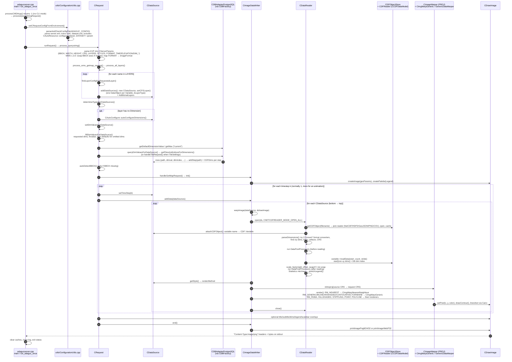
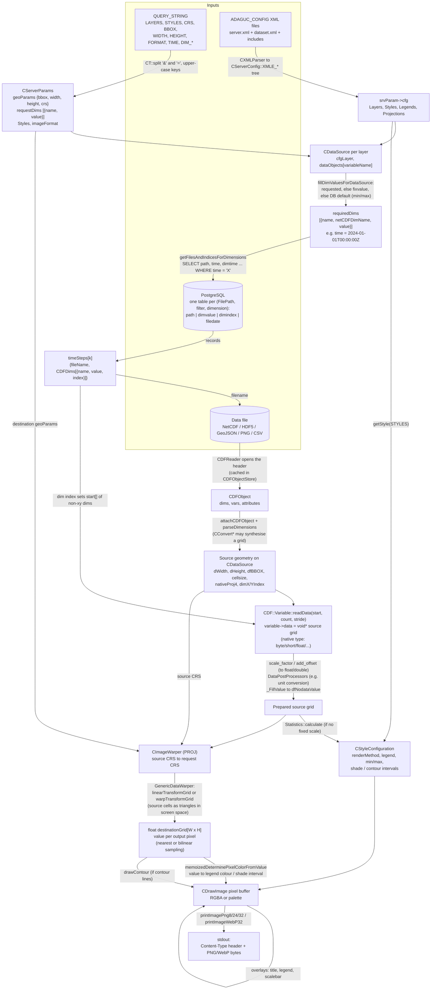
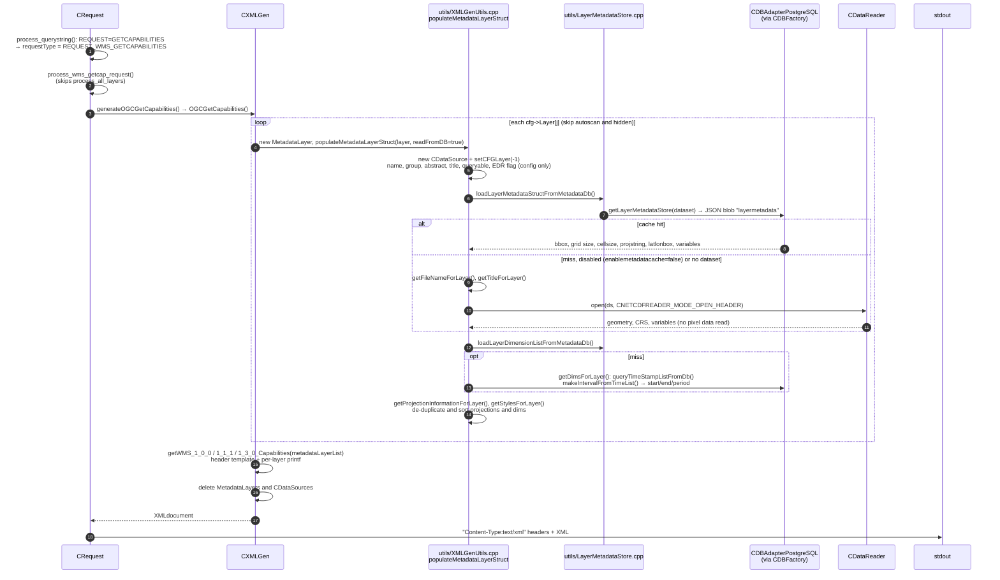
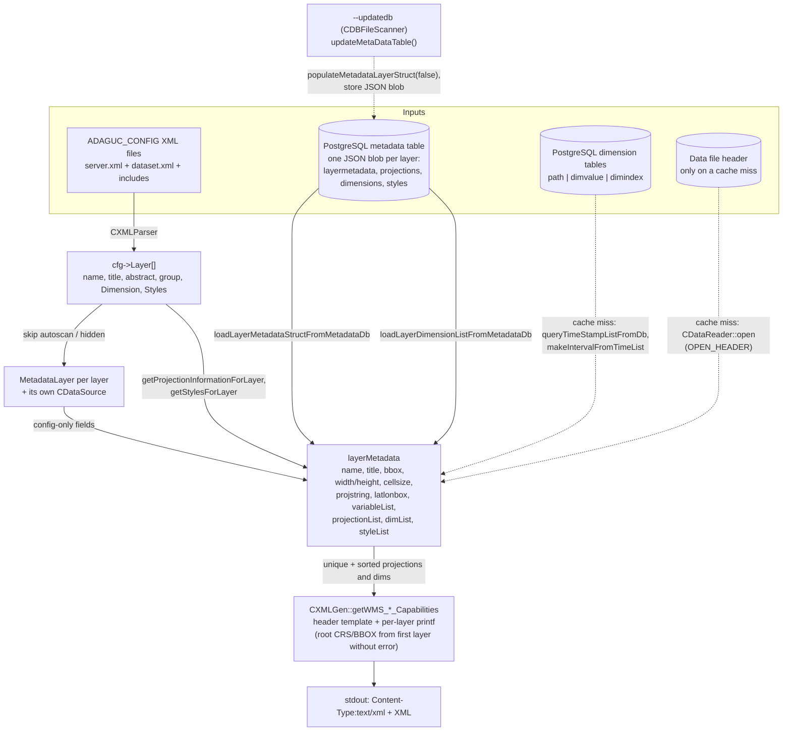

# WMS GetMap: code flow and data flow (C++)

[Back to readme](../../../Readme.md)

This document follows a single `SERVICE=WMS&REQUEST=GetMap` request through `bin/adagucserver`. It covers a normal `database` layer that serves a regular gridded NetCDF file. Paths are relative to `adagucserverEC/` unless stated otherwise. Line numbers refer to `master` at `36989f97` (version 10.0.0).

Each request runs in its own process, either a fresh process or a child forked by the fork server. The Python wrapper sets `QUERY_STRING` and `ADAGUC_CONFIG` in the environment, and the binary writes HTTP headers plus the image body to stdout. Global singletons and caches (`CDFObjectStore`, `CDBFactory`, proj caches) are cleared when the process finishes (`adagucserver.cpp`, `run_adaguc_once`).

## Key objects

| Object | What it holds | Lifetime |
|---|---|---|
| `CServerParams` (`CServerParams.h`) | The parsed request (`geoParams` = BBOX/WIDTH/HEIGHT/CRS, `requestDims`, `Styles`, `imageFormat`, ...) plus `cfg`, the merged XML config | Whole request; owned by `CRequest` |
| `CServerConfig::XMLE_*` (`CServerConfig_CPPXSD.h`) | The XML config as a tree of structs (`cfg->Layer[i]`, `cfg->Style`, `cfg->Legend`, ...) | Whole request |
| `CDataSource` (`CDataSource.h`) | One layer to draw: `cfgLayer`, `requiredDims`, `timeSteps` (one filename per step + dim indices), `dataObjects` (one per `<Variable>`), and the native grid geometry (`dWidth/dHeight/dfBBOX/nativeProj4`) | Created per requested layer in `CRequest::addDataSources` |
| `DataObject` (`CDataSource.h`) | Links one `<Variable>` to its `CDF::Variable` (data buffer), nodata value, points, features | Inside `CDataSource` |
| `CDFObject` / `CDF::Variable` (`../CCDFDataModel/`) | In-memory NetCDF-like model. `variable->data` is the raw `void*` grid | Cached per file in `CDFObjectStore` |
| `CStyleConfiguration` | The resolved style: `renderMethod` bitmask, legend index, shade/contour intervals, min/max/scale | Per `CDataSource` (`getStyle()`) |
| `CImageDataWriter` | Owns the output canvas `CDrawImage drawImage` and runs the renderers | Stack object in `handleGetMapRequest` |
| `CDrawImage` | RGBA (or palette) pixel buffer plus Cairo for text and lines. It encodes to PNG/WebP | Inside `CImageDataWriter` |

## 1. Code flow

Rendered image, best opened on its own to zoom and pan: [getmap-code-flow.svg](./getmap-code-flow.svg) ([PNG](./getmap-code-flow.png))

Notes on the code flow:

- **Dispatch** happens in two places. `process_querystring` (`CRequest.cpp`, about line 802 to 1944) is one large function that parses parameters and then branches on `srvParam->requestType`. `process_all_layers` (`CRequest.cpp:596`) is the shared path for all layer-based requests: GetMap, GetFeatureInfo, GetLegendGraphic, GetCoverage, etc. GetMap goes to `handleGetMapRequest` (`CRequest.cpp:2196`).
- **Errors** are mostly `CDBError(...)` followed by `return 1` or `throw(__LINE__)` (an `int`). `CServerError` / `readyHandleError()` in `main` turns the collected errors into a ServiceException in the right format (XML, plain text, or an image for GetMap).
- **Multiple layers** (`LAYERS=a,b`) give multiple `CDataSource`s. All of them are drawn onto the same `drawImage`, in order. The palette is re-created per layer in `addData` (`CImageDataWriter.cpp:1109`).
- **Threading** is used only when the layer has `<TileSettings threads="N">`. In that case timesteps are spread over pthreads, each with cloned datasources (`CRequest.cpp`, inside `handleGetMapRequest`).
- **`liveupdate` layers** skip the DB and file path entirely (`layerTypeLiveUpdateRender`). **`grid` (graticule)** layers add an empty step and draw lines only.

## 2. Data flow

Rendered image: [getmap-data-flow.svg](./getmap-data-flow.svg) ([PNG](./getmap-data-flow.png))

The code flow is mostly function calls, but the data changes form several times: query string → structs → SQL → file index → raw grid → screen grid → pixels → PNG bytes. The diagram below follows the data instead of the calls.

Notes on the data flow:

- **The database is an index, not a data store.** It holds only filenames and dimension values plus their index along the file's dimension. It is filled offline by `--updatedb` (`CDBFileScanner`), or on the fly for autowms/`source=` requests (`autoUpdateAndScanDimensionTables`). The pixel data always comes from the file.
- **The dimension index** from the DB (`dimtime` etc.) becomes `start[j]` for the non-spatial dimensions in `CDataReader::open` (`CDataReader.cpp`, around line 976). The whole x/y slab is read (`count = dOrigWidth x dHeight`) with an optional `stride2DMap` for downsampling. The BBOX is **not** used to subset the read; `usePixelExtent` is hard-coded to `false` in `warpImage`.
- **Format converters** (`CConvert*`, tried in order in `CDataReader::parseDimensions`) are where non-regular inputs become something the renderers can handle. Examples are points, curvilinear grids, GeoJSON, UGRID, TROPOMI, and volume scans. When a converter is active it fills the data itself, and `readData` is skipped (`formatConverterActive`).
- **Two grids in the generic renderer:** the *source* grid (native type, native CRS) and a *destination* `float` grid at the output size. `GenericDataWarper` walks the source cells, projects their corners to screen space, and calls a draw function for every covered pixel. That function writes the sampled value into the destination grid and, if `drawgrid` is on, the colour into `CDrawImage`. Contours are computed afterwards from the destination float grid.
- **Colour** comes from the style: either a continuous legend scaled with `min/max` (`legendScale/legendOffset`, auto-stretched from the data statistics if not configured), or discrete `ShadeInterval`s.

## Which renderer draws the pixels

`CImageDataWriter::warpImage` (`CImageDataWriter.cpp:981` onwards) picks renderers with a series of **independent** `if` blocks on the style's `renderMethod` bitmask, not an `else if` chain. The keywords in `<RenderMethod>` are turned into bits by `getRenderMethodFromString` (`CStyleConfiguration.cpp:10`). That function uses substring matching, so `shadedcontour` sets both `RM_SHADED` and `RM_CONTOUR`.

| `<RenderMethod>` keyword | Bit | Renderer |
|---|---|---|
| `nearest` (also `linearinterpolation`) | `RM_NEAREST` | `CImgWarpNearestNeighbour` |
| `generic`, `bilinear`, `shaded`, `contour`, `vector`, `barb` | `RM_GENERIC`, `RM_BILINEAR`, `RM_SHADED`, `RM_CONTOUR`, `RM_VECTOR`, `RM_BARB` | `CImgWarpGeneric` |
| `rgba` | `RM_RGBA` | `CImgWarpNearestRGBA` |
| `point`, `polyline`, `stippling`, `hillshaded`, ... | their own bits | their own renderers |

Both the nearest and the generic renderer use `GenericDataWarper::render`, which walks the source cells and calls a draw function per covered destination pixel. The difference is in the draw function:

- **`CImgWarpNearestNeighbour`** (`CImgWarpNearestNeighbour.cpp:203`) builds a `GDWArgs` from the `CDataSource` geometry and calls `render<T>` with `CImgWarpNearestNeighbour::drawFunction` (line 463). That function maps the value to a colour and writes it **directly into `CDrawImage`**. There is no intermediate float destination grid.
- **`CImgWarpGeneric`** (`CImgWarpGeneric.cpp:174`) writes the sampled value into a `float` destination grid first, optionally draws the colour, and only then computes contour lines from that grid. This is the pipeline shown in the data-flow diagram above.

`GenericDataWarper::render` (`CGenericDataWarper.h:359`) chooses `linearTransformGrid` when `warper->isProjectionRequired()` is false (source CRS equals the request CRS) and `warpTransformGrid` otherwise. Both renderers go through this choice.

Because the `if` blocks are independent, a style with `nearest,shaded` runs `CImgWarpNearestNeighbour` and then `CImgWarpGeneric` on the same image.

### Worked examples

| Example | Config | Result |
|---|---|---|
| KNMI radar, `STYLES=radar/nearest`, `CRS=EPSG:3857` (CLion run configuration "adagucserver GetMap radar") | Layer `precipitation_real_time` with `<DataReader>HDF5</DataReader>`, style `radar` has `<RenderMethod>nearest</RenderMethod>` | `CImgWarpNearestNeighbour` → `GenericDataWarper`. `EPSG:3857` differs from the HDF5 source CRS (not checked), so `warpTransformGrid`; the "native grid" run configurations should take `linearTransformGrid`. |
| Same layer with the second style `rainrate-blue-to-purple` | `<RenderMethod>nearest,shaded</RenderMethod>` | Both renderers run, see above. |
| HARMONIE netCDF, layer `air_temperature_hagl`, style `temperature` (`knmi_ha43_nl_2p5km.xml` with `includes/StandardStyles_WIK.xml`, from the kdp-adaguc repository) | netCDF files (`...geoweb_nc_...nc`, default reader), `<RenderMethod>shaded,shadedcontour</RenderMethod>` | `RM_SHADED \| RM_CONTOUR` → `CImgWarpGeneric` with `ShadeInterval` colours plus `ContourLine` lines. |

## See also

- [Proposal: an explicit request pipeline](./request-pipeline-proposal.md): why the deep call tree (`addData` → `warpImage` → `CDataReader::open`) is hard to follow, and a step-by-step plan to restructure it.

## Where to start reading

1. `CRequest::process_all_layers` (`CRequest.cpp:596`): the main dispatch.
2. `CRequest::setDimValuesForDataSource` (`CRequest.cpp:181`) and `CDBAdapterPostgreSQL::getFilesAndIndicesForDimensions` (`CDBAdapterPostgreSQL.cpp:404`): from dimensions to files.
3. `CRequest::handleGetMapRequest` (`CRequest.cpp:2196`): the GetMap loop.
4. `CImageDataWriter::warpImage` (`CImageDataWriter.cpp:865`): read, pick renderer, render.
5. `CDataReader::open` (`CDataReader.cpp:849`): file to memory.
6. `CImgWarpGeneric::render` (`CImgWarpGeneric/CImgWarpGeneric.cpp:174`) and `GenericDataWarper::render` (`CGenericDataWarper.h:359`): reprojection and pixel drawing.

---

# WMS GetCapabilities: code flow and data flow (C++)

`REQUEST=GetCapabilities` follows a much shorter path than GetMap. It never reads pixel data and never creates a `CImageDataWriter`. It also does not go through `process_all_layers`: `process_querystring` dispatches straight to `process_wms_getcap_request` (`CRequest.cpp:123`). `CXMLGen::OGCGetCapabilities` (`CXMLGen.cpp:794`) builds its own `CDataSource` for every configured layer (skipping `type="autoscan"` and `hidden="true"`), so the `LAYERS=` parameter is not used.

## 1. Code flow

Rendered image: [getcap-code-flow.svg](./getcap-code-flow.svg) ([PNG](./getcap-code-flow.png))

Notes:

- **`populateMetadataLayerStruct`** (`utils/XMLGenUtils.cpp:18`) fills a `MetadataLayer.layerMetadata` struct. The `getWMS_*_Capabilities` generators only format that struct.
- **Metadata cache:** `--updatedb` stores one JSON blob per layer (`updateMetaDataTable`, `utils/LayerMetadataStore.cpp:336`, called from `CDBFileScanner.cpp:995`). When the blob is found, GetCapabilities does no file I/O. It is skipped with `<Settings enablemetadatacache="false">` (`CServerParams::useMetadataTable`) or when no dataset is set. `getLayerMetadataFromDb` throws an `int` when no entry exists, and `loadLayerMetadataStructFromMetadataDb` catches it and returns non-zero, which triggers the slow path.
- **Slow path:** `getFileNameForLayer` picks a representative file and `CDataReader::open` runs in `CNETCDFREADER_MODE_OPEN_HEADER`, which reads geometry, CRS and variable attributes but no grid data.
- **Dimensions:** time dimensions with regular steps are compressed to `start/end/period` by `makeIntervalFromTimeList`; otherwise `handleMultipleValueDim` lists the values.
- **Errors per layer** set `hasError`. The layer is skipped (or gets an XML comment via `addErrorInXMLForMisconfiguredLayer`) and the document is still returned with status 200.
- **Root-level `<CRS>` and `<BoundingBox>`** in the WMS 1.3.0 document come from the first layer without an error (`getFirstLayerWithoutError`), not from the union of all layers.

## 2. Data flow

Rendered image: [getcap-data-flow.svg](./getcap-data-flow.svg) ([PNG](./getcap-data-flow.png))

