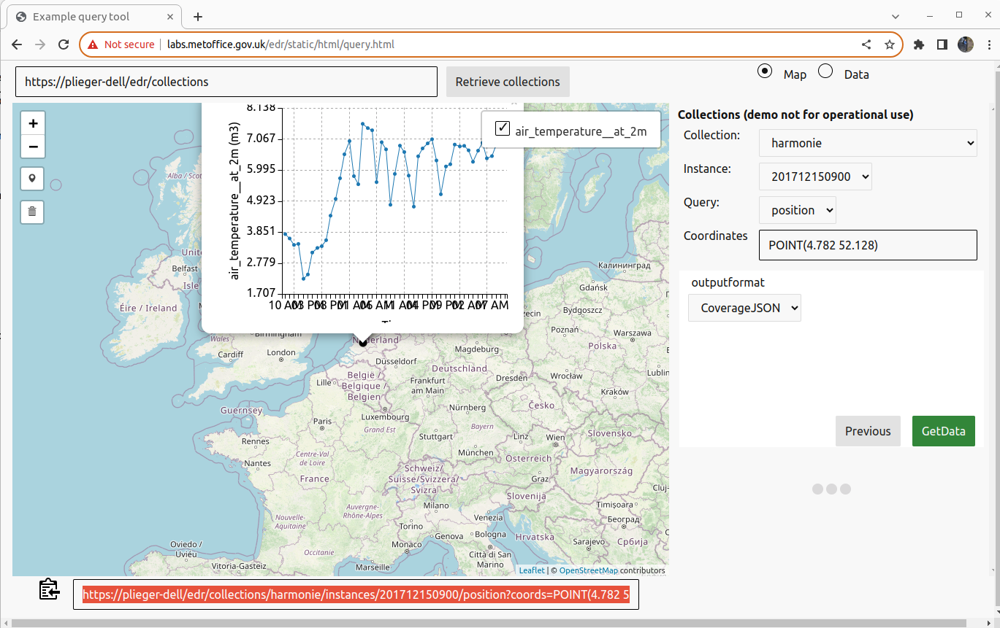

# Configure an EDR timeseries service using AdagucServer

- [Back to readme](./Readme.md)
- [Configuration details for EDR](../configuration/EDRConfiguration/EDR.md)

## Prerequisites

Make sure adaguc-server is running, follow the instructions at [Starting the adaguc-server with docker](../Running.md)

## Step 1: Copy a file with timesteps into the adaguc-data folder

Copy the file from the adaguc-server repository under `data/datasets/forecast_reference_time/HARM_N25_20171215090000_dimx16_dimy16_dimtime49_dimforecastreferencetime1_varairtemperatureat2m.nc` into the configured adaguc-data folder:

```bash
cp ${ADAGUC_PATH}/data/datasets/forecast_reference_time/HARM_N25_20171215090000_dimx16_dimy16_dimtime49_dimforecastreferencetime1_varairtemperatureat2m.nc ${ADAGUC_DATA_DIR}
```

## Step 2: Configure a dataset for this datafile, including EDR support

Create the following file at the filepath `$ADAGUC_DATASET_DIR/edr.xml`. You can also consider changing `<FilePath>` to `/data/adaguc-data/*.nc`.

```xml
<?xml version="1.0" encoding="UTF-8" ?>
<Configuration>
    <!-- Styles -->
    <Style name="temperature">
        <Legend fixedclasses="true" textformatting="%0.0f" tickinterval="2">bluewhitered</Legend>
        <Min>-10</Min>
        <Max>10</Max>
    </Style>

    <!-- Layers -->
    <Layer type="database">
        <Name>my_temperature</Name>
        <Title>Temperature</Title>
        <Abstract>The temperature at 2m height</Abstract>
        <Group collection="mycollection" />
        <FilePath>/data/adaguc-data/tutorial/HARM_N25_20171215090000_dimx16_dimy16_dimtime49_dimforecastreferencetime1_varairtemperatureat2m.nc</FilePath>
        <Variable units="Celsius" long_name="air_temperature">air_temperature__at_2m</Variable>
        <Styles>temperature</Styles>
    </Layer>
</Configuration>
```

For the given example this will result in the following parameter name definition:

```json
"parameter_names": {
  "my_temperature": {
    "type": "Parameter",
    "id": "my_temperature",
    "label": "Temperature",
    "description": "The temperature at 2m height",
    "unit": {
      "symbol": {
        "value": "Celsius",
        "type": "http://www.opengis.net/def/uom/UCUM"
      }
    },
    "observedProperty": {
      "id": "https://vocab.nerc.ac.uk/standard_name/air_temperature",
      "label": "air_temperature"
    }
  }
}
```

## Step 3: Scan the new data

```bash
docker exec -i -t my-adaguc-server scan.sh -d edr
```

## Step 4: Check if the EDR endpoint works

The EDR endpoint is at `/edr/collections`. This will list all the configured collections.

You can find the collection from above under `edr.mycollection`. This EDR collection name is a combination of the dataset name (`edr`) and the "group collection" (`mycollection`).

The following examples test the `/collections`, `/instances`, `/position` and the `/cube` EDR calls:
- https://yourhostname/edr/collections
- https://yourhostname/edr/collections/edr.mycollection
- https://yourhostname/edr/collections/edr.mycollection/instances
- https://yourhostname/edr/collections/edr.mycollection/instances/201712150900
- https://yourhostname/edr/collections/edr.mycollection/instances/201712150900/position?coords=POINT(4.782%2052.128)&datetime=2017-12-15T09:00Z/2017-12-17T09:00Z&parameter-name=air_temperature__at_2m&crs=EPSG:4326&f=CoverageJSON
- https://yourhostname/edr/collections/edr.mycollection/instances/201712150900/cube?bbox=5,52,7,54&datetime=2017-12-15T09:00Z/2017-12-17T09:00Z&parameter-name=air_temperature__at_2m&crs=EPSG:4326&f=CoverageJSON


You can also try pasting your EDR endpoint https://yourhostname/edr/collections in https://labs.metoffice.gov.uk/edr/static/html/query.html.


See:



## Resolution of cube queries

A cube query accepts two kinds of resolution parameters, both for EPSG:4326 and for `crs=native`. They cannot be
combined:

- **`resolution-x` and `resolution-y` (EDR):** the number of positions in x and y, as defined by OGC API EDR. In
  EPSG:4326 they set the width and height of the grid, and they must be given together. The positions are the cell
  centres of that grid, so they lie half a cell inside the bbox, not on its edges. `0`, or leaving them out, gives
  about the resolution of the data. With `crs=native` they give every n-th cell of the native grid, see below. The
  largest value is 20000.
- **`resolution_x` and `resolution_y` (ADAGUC extension, not part of EDR):** the cell size in the units of the `crs`:
  degrees for EPSG:4326, and native units (like metres or rotated degrees) for `crs=native`, see below. They must be
  larger than 0, and in EPSG:4326 they must be given together. A cell size larger than the bbox gives one cell. Note
  the underscore: these are not the same as the EDR parameters with a hyphen.

An invalid value, like a negative number or a number above 20000, returns HTTP 400.

```text
/edr/collections/edr.mycollection/cube?bbox=5,52,7,54&parameter-name=my_temperature&resolution-x=20&resolution-y=20
/edr/collections/edr.mycollection/cube?bbox=5,52,7,54&parameter-name=my_temperature&resolution_x=0.1&resolution_y=0.1
```


## Precision of the values of cube queries

The values in a cube response are written with the digits the data has, not with the noise of how they are stored:
`3.8` for packed data that unpacks to `3.8000000000000003` (rounded to 12 significant digits), and `-21.036102` for
the 32 bit float `-21.036102294921875` (the fewest of 7, 8 or 9 significant digits that give the same 32 bit float).
The coordinates of the axes are written the same way. This loses nothing, and makes the response about a fifth
smaller after compression.

## Cube queries on the native grid (`crs=native`)

By default `/cube` resamples the data to a regular EPSG:4326 grid with nearest neighbour. The values are real values,
but they are not at the cell centres of the source grid. For a rotated pole or projected grid, some source cells can
also be left out. With `crs=native` the cube returns the cells of the source grid itself, without resampling:

```text
/edr/collections/edr.mycollection/instances/201712150900/cube?bbox=100000,400000,250000,550000&datetime=2017-12-15T09:00Z&parameter-name=my_temperature&crs=native
```

- **Availability:** a collection offers `native` only when all its EDR parameters share one projection, and that
  projection is not EPSG:4326. Their grids can differ in extent or cell size. It is then listed in the `crs` list of
  the collection, and in the `crs_details` of the cube query with the WKT of the projection.
- **bbox:** the values are in the coordinates of the native grid, not in longitude/latitude. In this example these
  are metres in the Dutch RD grid (EPSG:28992). For a rotated pole grid they are rotated degrees. Every cell that
  intersects the bbox is returned. To choose a bbox without converting coordinates, use the extent of the native grid
  in its `crs_details` entry (see below). To convert longitude/latitude yourself, use the WKT, for example with pyproj.
- **Native extent (ADAGUC extension):** the `native` entry in `crs_details` also gives the extent of the grid in
  native coordinates. EDR only defines `crs` and `wkt` in `crs_details`; these members are added by ADAGUC, so generic
  EDR clients do not use them:
  - `bbox`: `minx, miny, maxx, maxy` of the outer cell edges. Requesting this bbox returns the whole grid. When the
    parameters have different grids in the same projection, the bbox covers all of them.
  - `cellsize`: the cell size in x and y, and `size`: the number of cells in x and y. These are only given when all
    parameters of the collection have the same grid.

  ```json
  "crs_details": [
    { "crs": "EPSG:4326", "wkt": "GEOGCS[\"WGS 84\",...]" },
    {
      "crs": "native",
      "wkt": "GEOGCRS[\"undefined\",...,DERIVINGCONVERSION[\"Pole rotation (netCDF CF convention)\",...]]",
      "bbox": [-1.475, -2.155, 1.385, 0.925],
      "cellsize": [0.11, 0.11],
      "size": [26, 28]
    }
  ]
  ```

- **Response:** the `x` and `y` axes are the cell centres of the native grid. The CoverageJSON `referencing` gives the
  EPSG id of the grid when there is one. CoverageJSON has no way to give a CRS as WKT, so a grid without an EPSG id,
  like a rotated pole grid, has only a `type` and no `id`. Its WKT is in the `native` entry of `crs_details`, given as
  a CF rotated pole.
- **Fewer cells:** with `resolution-x`/`resolution-y` (the number of positions) the cube returns every n-th cell of
  the native grid, for at most that many positions. The values stay cells of the native grid, without interpolation:
  the middle cell of each block of n cells. So the positions are not exactly at the bbox edges, as EDR describes for
  interpolated data. `0`, or at least as many positions as there are cells, gives every cell.
  With `resolution_x`/`resolution_y` (the cell size in native units) the cell size is rounded to a whole number of
  native cells, and the cube returns every n-th cell in the same way. For example, `resolution_x=0.33` on a grid of
  0.11 rotated degrees gives every 3rd cell. A cell size larger than the bbox gives one cell.
  Both kinds can also be given for one axis only; the other axis then keeps every cell.
- **Errors (HTTP 400):** a bbox outside the grid and a collection without `native` return 400. `/position` and
  `/trajectory` refuse `crs=native`, because their coordinates are longitude/latitude.

Without `crs`, or with any spelling of EPSG:4326 (`EPSG:4326`, `CRS84`, `OGC:CRS84` or their URIs), the cube returns
EPSG:4326 as before. Other values return HTTP 400.

The response to the example above, shortened. The `x` and `y` values are the cell centres of the RD grid in metres,
and the `referencing` names the grid by its EPSG id:

```json
{
  "type": "Coverage",
  "domain": {
    "type": "Domain",
    "domainType": "Grid",
    "axes": {
      "x": { "values": [89358.73, 140129.71, 190900.69, 241671.67] },
      "y": { "values": [526168.54, 477279.61, 428390.67, 379501.74] },
      "t": { "values": ["2017-12-15T09:00:00Z"] }
    },
    "referencing": [
      {
        "coordinates": ["x", "y"],
        "system": { "type": "ProjectedCRS", "id": "http://www.opengis.net/def/crs/EPSG/0/28992" }
      },
      {
        "coordinates": ["t"],
        "system": { "type": "TemporalRS", "calendar": "Gregorian" }
      }
    ]
  },
  "ranges": {
    "my_temperature": {
      "type": "NdArray",
      "dataType": "float",
      "axisNames": ["t", "y", "x"],
      "shape": [1, 4, 4],
      "values": [6.22, 1.46, 2.07, 1.86, 3.79, 2.20, 1.87, 2.23, 2.09, 2.32, 2.70, 2.27, 2.72, 2.72, 2.53, 2.57]
    }
  }
}
```

A grid without an EPSG id, like a rotated pole grid, has no `id`. The `x` and `y` values are then rotated longitudes
and latitudes, and the WKT of the `native` entry in `crs_details` tells how to convert them:

```json
"system": { "type": "GeographicCRS" }
```

Generic CoverageJSON clients treat a `GeographicCRS` as plain longitude/latitude, so they draw a rotated pole grid in
the wrong place. Use the WKT from `crs_details` to convert the coordinates.

## Trajectory queries

Use `/trajectory` on a collection or instance with a 2D WKT `LINESTRING`:

```text
/edr/collections/edr.mycollection/trajectory?coords=LINESTRING(4.7%2052.1,5.5%2052.5)&parameter-name=my_temperature&z=*
```

The response is a CoverageJSON Section with selected levels in `z` and
`[time, longitude, latitude]` tuples along the path. It returns native cell centres
and values without interpolation. Consecutive duplicate cells are suppressed;
later revisits remain. Omitted `z` selects all visible levels; hidden heights keep
their configured selection and are reported in `z`. Omitted `datetime` uses the
configured default, as for position. Without `parameter-name`, only parameters
with time and an explicitly typed vertical dimension are selected. Explicitly
requesting an unsuitable parameter returns HTTP 400. A path outside the grid
returns HTTP 404.

Supported: numeric parameters with time and a vertical dimension configured with `type="vertical"`,
on regular grids with matching one-dimensional axes across source files,
including rotated-pole grids. Each axis needs at least two cells; spatial
dimensions must be the final two variable dimensions. Layers requiring multiple
source variables or `orgname` renaming are unsupported.

Only `EPSG:4326` and CoverageJSON are supported. `resolution_x`, `resolution_y`,
`resolution-x` and `resolution-y` are rejected; rendering stride is ignored. Vertical coordinates must be finite
numbers. Failed trajectory data calls return HTTP 400.

The current fixed limits are:

- **1,000 input vertices:** coordinate pairs supplied in the `LINESTRING`.
- **2,000 path samples per layer:** crossed grid cells in path order, including
  later revisits. Consecutive duplicates do not count again.
- **1 million sample/dimension combinations per layer:** path samples multiplied
  by the number of selected time/level/member/other dimension combinations.
  For example, 500 samples × 20 times × 90 levels counts as 900,000.

The value limit applies separately to each parameter, not to the whole response.
The existing database `maxquerylimit` also restricts dimension selections, and
source files across all requested parameters must fit the file store's open-file
capacity. Complex projected paths can hit a separate subdivision limit.
