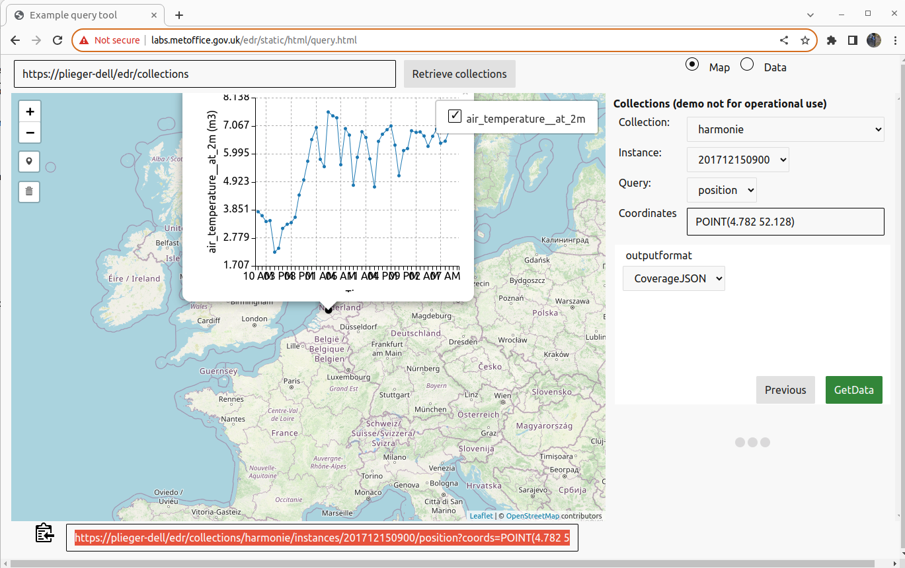

# Configure an EDR timeseries service using AdagucServer

- [Back to readme](./Readme.md)
- [Configuration details for EDR](../configuration/EDRConfiguration/EDR.md)

## Prerequisites

Make sure adaguc-server is running, follow the instructions at [Starting the adaguc-server with docker](../Running.md)

## Step 1: Copy a file with timesteps into the adaguc-data folder

Copy the file from the adaguc-server repository under `data/datasets/forecast_reference_time/HARM_N25_20171215090000_dimx16_dimy16_dimtime49_dimforecastreferencetime1_varairtemperatureat2m.nc` into the configured adaguc-data folder:

```bash
cp ${ADAGUC_PATH}/data/datasets/forecast_reference_time/HARM_N25_20171215090000_dimx16_dimy16_dimtime49_dimforecastreferencetime1_varairtemperatureat2m.nc ${ADAGUC_DATA_DIR}
```

## Step 2: Configure a dataset for this datafile, including EDR support

Create the following file at the filepath `$ADAGUC_DATASET_DIR/edr.xml`. You can also consider changing `<FilePath>` to `/data/adaguc-data/*.nc`.

```xml
<?xml version="1.0" encoding="UTF-8" ?>
<Configuration>
    <!-- Styles -->
    <Style name="temperature">
        <Legend fixedclasses="true" textformatting="%0.0f" tickinterval="2">bluewhitered</Legend>
        <Min>-10</Min>
        <Max>10</Max>
    </Style>

    <!-- Layers -->
    <Layer type="database">
        <Name>my_temperature</Name>
        <Title>Temperature</Title>
        <Abstract>The temperature at 2m height</Abstract>
        <Group collection="mycollection" />
        <FilePath>/data/adaguc-data/tutorial/HARM_N25_20171215090000_dimx16_dimy16_dimtime49_dimforecastreferencetime1_varairtemperatureat2m.nc</FilePath>
        <Variable units="Celsius" long_name="air_temperature">air_temperature__at_2m</Variable>
        <Styles>temperature</Styles>
    </Layer>
</Configuration>
```

For the given example this will result in the following parameter name definition:

```json
"parameter_names": {
  "my_temperature": {
    "type": "Parameter",
    "id": "my_temperature",
    "label": "Temperature",
    "description": "The temperature at 2m height",
    "unit": {
      "symbol": {
        "value": "Celsius",
        "type": "http://www.opengis.net/def/uom/UCUM"
      }
    },
    "observedProperty": {
      "id": "https://vocab.nerc.ac.uk/standard_name/air_temperature",
      "label": "air_temperature"
    }
  }
}
```

## Step 3: Scan the new data

```bash
docker exec -i -t my-adaguc-server scan.sh -d edr
```

## Step 4: Check if the EDR endpoint works

The EDR endpoint is at `/edr/collections`. This will list all the configured collections.

You can find the collection from above under `edr.mycollection`. This EDR collection name is a combination of the dataset name (`edr`) and the "group collection" (`mycollection`).

The following examples test the `/collections`, `/instances`, `/position` and the `/cube` EDR calls:
- https://yourhostname/edr/collections
- https://yourhostname/edr/collections/edr.mycollection
- https://yourhostname/edr/collections/edr.mycollection/instances
- https://yourhostname/edr/collections/edr.mycollection/instances/201712150900
- https://yourhostname/edr/collections/edr.mycollection/instances/201712150900/position?coords=POINT(4.782%2052.128)&datetime=2017-12-15T09:00Z/2017-12-17T09:00Z&parameter-name=air_temperature__at_2m&crs=EPSG:4326&f=CoverageJSON
- https://yourhostname/edr/collections/edr.mycollection/instances/201712150900/cube?bbox=5,52,7,54&datetime=2017-12-15T09:00Z/2017-12-17T09:00Z&parameter-name=air_temperature__at_2m&crs=EPSG:4326&f=CoverageJSON


You can also try pasting your EDR endpoint https://yourhostname/edr/collections in https://labs.metoffice.gov.uk/edr/static/html/query.html.


See:



## Trajectory queries

The collection and instance endpoints also support `/trajectory` with a simple
2D WKT `LINESTRING`, for example:

```text
/edr/collections/edr.mycollection/trajectory?coords=LINESTRING(4.7%2052.1,5.5%2052.5,6.0%2053.0)&parameter-name=my_temperature&z=*
```

Trajectory selects the native grid cells crossed by the line, in path order,
without interpolating values. Returned coordinates are the cell centres,
expressed as longitude and latitude. Consecutive duplicate cells are suppressed;
later revisits are retained. Cells use half-open boundaries: an exact edge belongs
to its positive native-index side, and corner-only touches do not add extra cells.
Parts outside the grid are clipped; a path with no samples returns HTTP 404.

The initial implementation supports numeric parameters on regular grids with
one-dimensional, uniformly spaced axes, including rotated-pole grids. Each axis
must contain at least two cells. The legacy reader requires spatial dimensions
in the final two NetCDF variable positions, in either x/y order. Point, curvilinear and unstructured datasets,
and layers requiring multiple source variables or per-layer variable renaming
with `orgname`, are not supported. Source files
for a parameter must share the same spatial grid. Only plain 2D `LINESTRING`
coordinates in `EPSG:4326` are supported. Segments are straight in the input
coordinate system and are subdivided for transformation to the native grid.
Rendering stride settings are ignored so trajectory always selects native cells.

The response has CoverageJSON `domainType: "Section"`. Its `composite` axis
contains `[time, longitude, latitude]` tuples, ordered by time and then path order.
Its `z` axis contains the selected levels. `z=*` selects all levels of a visible
vertical dimension; `z=10` selects a single level. Omitted `z` uses the same helper
as position and cube, which selects all visible vertical levels. A hidden height
retains its configured selection and is included in the Section domain when its
meaning is known. For example, a hidden height fixed at 2 m still returns `z: [2]`
when the request specifies `z=3`; the response always reports the selected height.
Parameters without a selected time or identifiable vertical coordinate are
rejected, rather than assigned an artificial height.

Instance selection, parameter selection and custom dimension selection follow
the existing endpoints. Omitted `datetime` follows position's configured default;
cube currently differs by explicitly requesting all times. Multiple selected
times repeat the path at each time. Each parameter and custom dimension selection
has its own coverage, as in the existing converters. Missing values are `null`.

Trajectory makes one metadata request and one native `GetTrajectory` data request
for all parameters. Native reads combine contiguous selected cells into row runs
and reuse each source file's open handle within the request. The data request is
limited to the file store's capacity (currently 500 files), 100,000 path samples,
and 10 million sample/dimension combinations per layer.

The cube extensions `resolution_x` and `resolution_y` do not apply to trajectory:
there is no output raster to resize. Passing them returns HTTP 400. Supporting a
coarser path selection would require a separate sampling policy.

Trajectory is advertised for collections with at least one parameter having time
and an identifiable vertical coordinate. The native reader checks grid support
when a request is executed. Unsupported grids or request limits return HTTP 422;
execution failures or malformed native responses return HTTP 500. Invalid
endpoint options remain HTTP 400, and an empty path result is HTTP 404.
