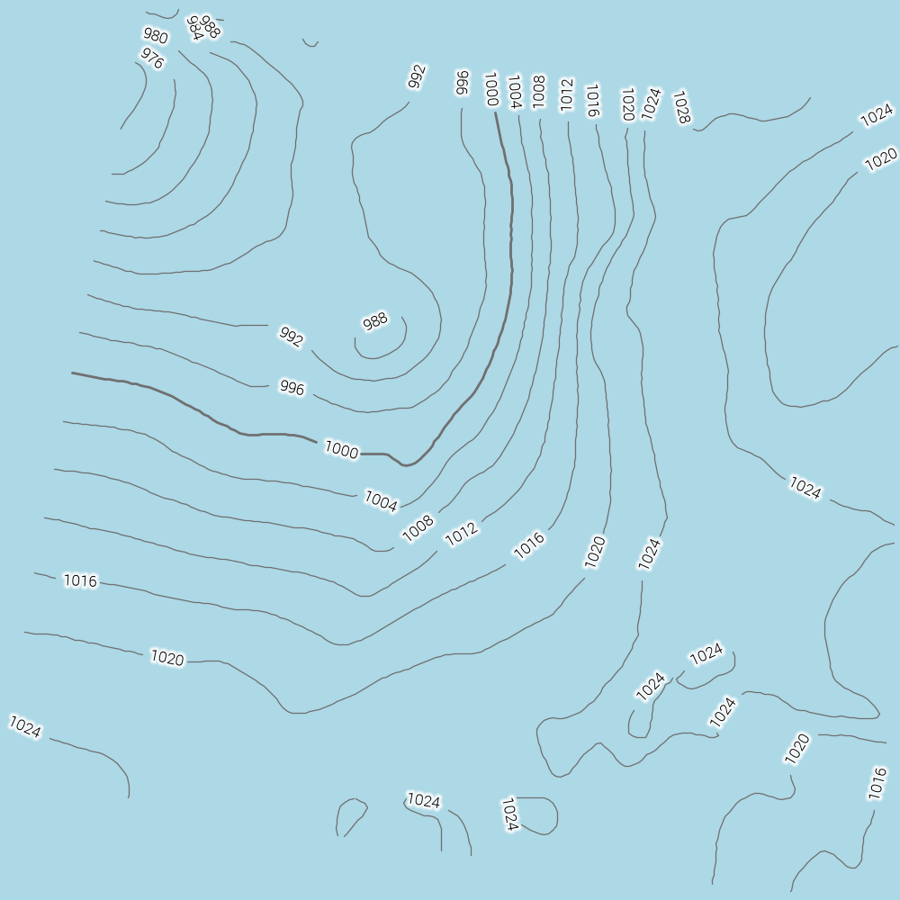
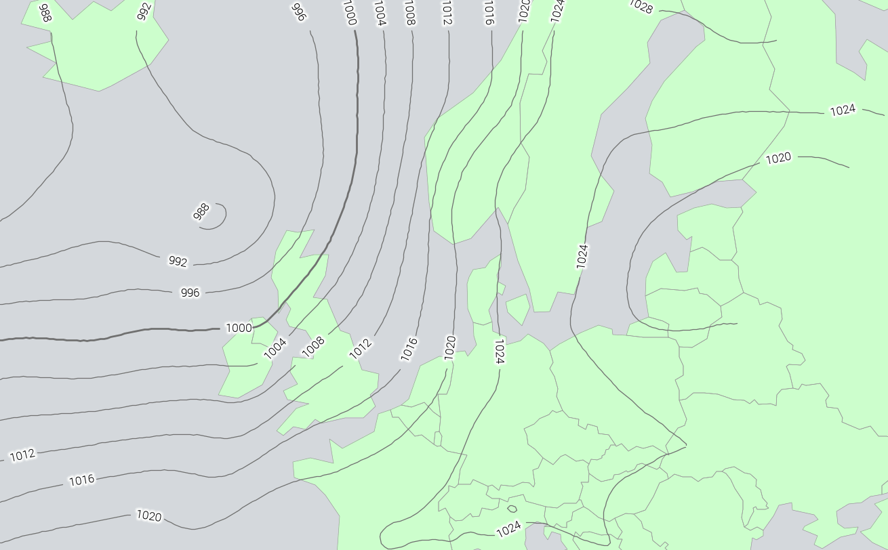
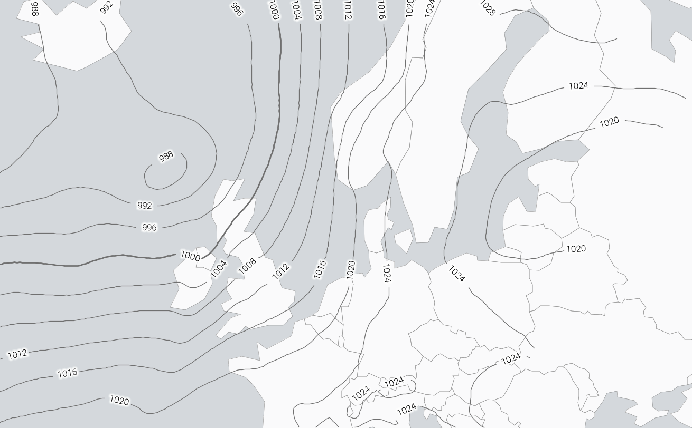
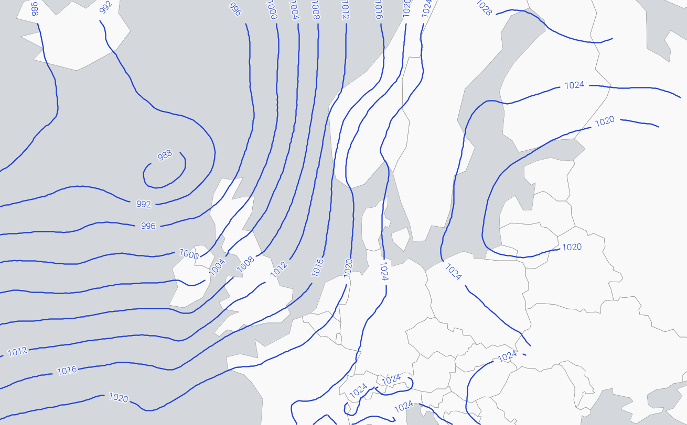

# Configuring synoptic weather chart style contourlines

- [Back to readme](./Readme.md)

This tutorial builds up a [ContourLine](../configuration/ContourLine.md) style
step by step, from a plain interval-based contour line to a full isobar chart
with labels, a bold reference line, and a land/sea base map - similar to the
isobars on a typical synoptic weather chart or shipping forecast.

A complete, working version of every style shown here is in
[adaguc.tests.contourtest.xml](../../data/config/datasets/adaguc.tests.contourtest.xml),
used by [TestContour.py](../../tests/AdagucTests/TestContour.py).

## Prerequisites

Make sure adaguc-server is running, follow the instructions at
[Starting the adaguc-server with docker](../Running.md). You'll also need a
gridded NetCDF field to draw contours on - a mean sea level pressure field is
used throughout this tutorial, but any 2D scalar field works the same way.

## Step 1: A plain contour line

Start with the basics: draw a line at every `interval`, label it with
`textformatting`, in a given `linecolor`/`textcolor`:

```xml
<Style name="pressure_basic" title="Basic pressure contours">
  <ContourLine width="0.8" linecolor="#707070" textcolor="#000000"
               textformatting="%2.0f" interval="4"/>
  <RenderSettings interpolationmethod="bilinear"/>
  <StandardNames standard_name="air_pressure_at_mean_sea_level"/>
</Style>
```

On real model output this usually looks noisier than a hand-drawn chart -
model grids have grid-scale detail that turns into small, distracting
wiggles once traced as contour lines.

## Step 2: Smooth the field before tracing

A [SmoothingFilter](../configuration/Style.md) applied to the field before
contour tracing removes most of that grid-scale noise, at the cost of some
detail:

```xml
<Style name="pressure_basic" title="Basic pressure contours">
  <ContourLine width="0.8" linecolor="#707070" textcolor="#000000"
               textformatting="%2.0f" interval="4"/>
  <SmoothingFilter>4</SmoothingFilter>
  <RenderSettings interpolationmethod="bilinear"/>
  <StandardNames standard_name="air_pressure_at_mean_sea_level"/>
</Style>
```

Use a larger value (e.g. `10`) for an even cleaner look on noisier fields -
see `pressure_msl_contour_outlined_extrasmooth` in
[adaguc.tests.contourtest.xml](../../data/config/datasets/adaguc.tests.contourtest.xml)
for an example.

## Step 3: Label spacing, and letting lines run under their own labels

By default a line gaps around every label (its own, and any other contour
definition's) that it passes under - `textgap="false"` disables that, so the
line is traced straight through instead. Combine it with a `textstrokecolor`
and `textstrokewidth` wide and opaque enough that the label's own background
hides the line underneath it, rather than the line showing through the text.
`textsofthalo="true"` draws that outline as a soft, blurred-looking halo
(closer to the label style on a real chart) instead of a single crisp
stroke. `textdistance` controls how often a line repeats its label (in
pixels, along the traced line):

```xml
<ContourLine width="0.8" linecolor="#707070" textcolor="#000000"
             textstrokecolor="#FFFFFF" textstrokewidth="4" textsize="12"
             textformatting="%2.0f" interval="4" textdistance="100"
             textsofthalo="true"/>
```



## Step 4: Emphasize a reference line

Many synoptic charts draw one particular isobar (commonly 1000 hPa) bolder
than the rest, as a quick visual reference. `boldvalues` takes a
comma-separated list of binned values to draw at `boldwidth` instead of the
regular `width`:

```xml
<ContourLine width="1.3" linecolor="#707070" textcolor="#000000"
             textstrokecolor="#FFFFFF" textstrokewidth="4" textsize="12"
             textformatting="%2.0f" interval="4" textdistance="100"
             textsofthalo="true" boldvalues="1000" boldwidth="2.8"/>
```

## Step 5: A land/sea base map

Isobars alone are hard to read without a geographic reference. Add a country
outline layer and a land-fill layer, both pointing at the same
`countries.geojson`, and draw them *underneath* the isobar layer in the
`LAYERS` request parameter:

```xml
<Style name="country_outline_light" title="Light gray country outlines">
  <Legend fixedclasses="true" tickinterval="1000" tickround="1">baselayer</Legend>
  <Min>0.0</Min>
  <Max>1000</Max>
  <RenderMethod>polyline</RenderMethod>
  <FeatureInterval match=".*" matchid="abbrev" bordercolor="#999999" borderwidth="0.7"/>
</Style>

<Style name="country_land_light" title="Light land fill">
  <Legend fixedclasses="true" tickinterval="1000" tickround="1">baselayer</Legend>
  <Min>0.0</Min>
  <Max>1000</Max>
  <RenderMethod>nearest</RenderMethod>
  <!-- bgcolor is the sea (outside any country polygon), fillcolor is the land.
       A fully transparent bgcolor (#00000000) lets the request's own BGCOLOR
       show through as the sea color. -->
  <FeatureInterval match=".*" matchid="abbrev" bgcolor="#00000000" fillcolor="#FAFAFBFF"/>
</Style>
```

> The `Legend` element here refers to a palette named `baselayer` - already
> defined project-wide in `DefaultLayers.include.xml` if your configuration
> includes it (as `adaguc.tests.dataset.xml` does). If you're writing a
> standalone dataset file that won't necessarily be loaded alongside that
> include, define your own `<Legend name="..." type="interval"><palette
> min="0" max="240" red="0" green="0" blue="0"/></Legend>` instead, under a
> name of your own, so the file doesn't depend on another config's content.
> See `contourtest_baselayer` in
> [adaguc.tests.contourtest.xml](../../data/config/datasets/adaguc.tests.contourtest.xml)
> for a worked example.

A classic-map green (`fillcolor="#CCFFCCFF"`, the same color the production
`baselayer` style uses) works just as well as the pale off-white shown above
- see `country_land_green` in
[adaguc.tests.contourtest.xml](../../data/config/datasets/adaguc.tests.contourtest.xml).
Combined with the extra-smoothed isobars from step 2:



Request the land, outline and pressure layers together, land first:

```
LAYERS=country_land,country_outline,pressure&STYLES=,,pressure_contourstyle
&TRANSPARENT=FALSE&BGCOLOR=0xD5D9DD
```

A muted, slightly blue-tinted gray (`0xD5D9DD`) for `BGCOLOR` reads as "sea"
convincingly, without the heavier look of a fully saturated blue.



## Variation: a plain marine-chart style

Not every contour style needs a label halo - on an uncluttered background,
plain colored lines and labels read fine on their own. Leaving
`textstrokecolor` unset (or fully transparent) draws plain text with no
outline at all:

```xml
<ContourLine width="1.3" linecolor="#0000FF" textcolor="#0000FF"
             textformatting="%2.0f" interval="4" textdistance="100" textsize="12"/>
```



## Reference

See [ContourLine](../configuration/ContourLine.md) for the full attribute
list, and
[adaguc.tests.contourtest.xml](../../data/config/datasets/adaguc.tests.contourtest.xml)
for all of the styles built in this tutorial (and a few more variations)
as a single, complete, working configuration file.
