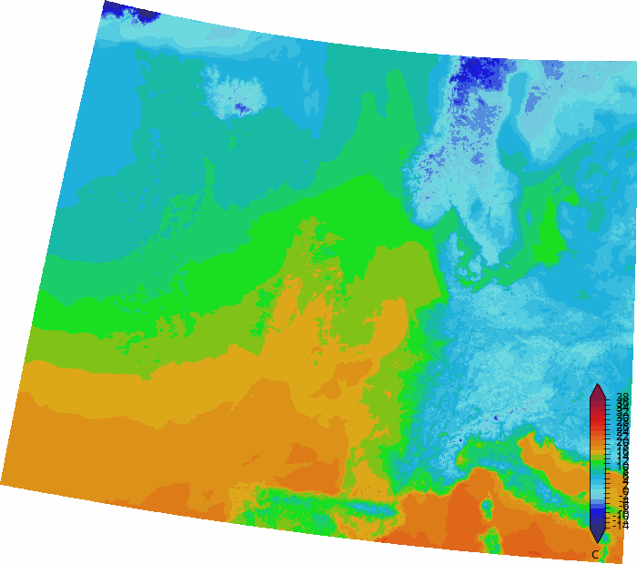
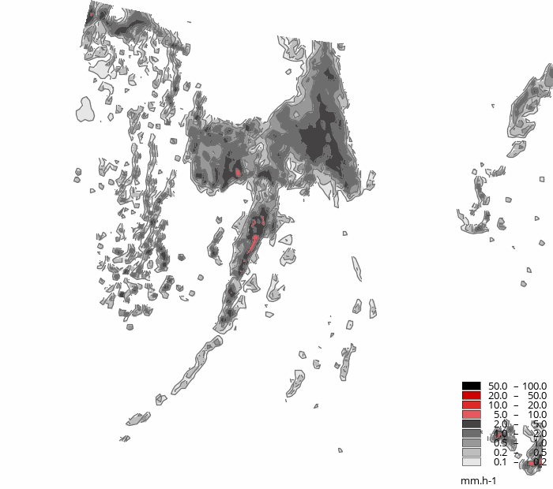
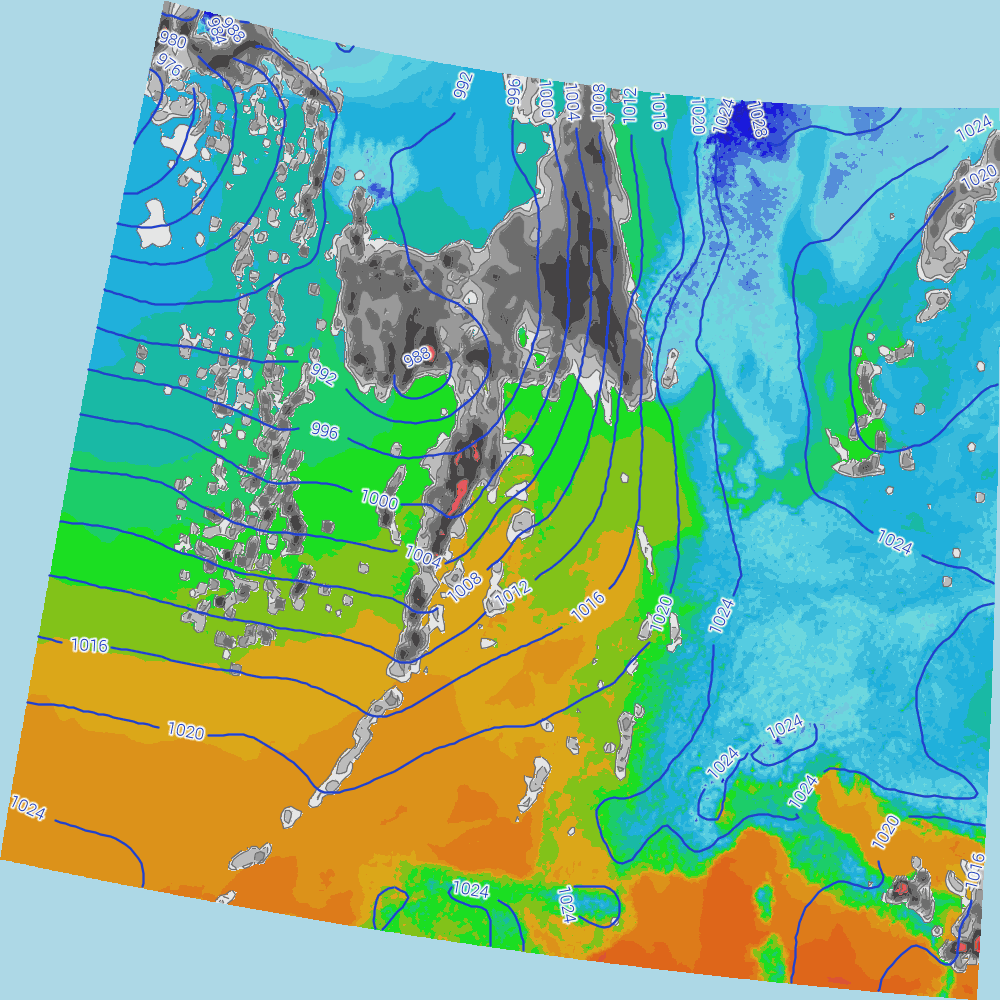

# Creating a combined synoptic overview map

- [Back to readme](./Readme.md)

A single `GetMap` request can combine several `Layers`, each with its own
`Style`, into one composited image - layers are drawn in the order they're
listed, first layer at the bottom. This tutorial builds up a synoptic-style
overview that stacks three fields on top of each other: a filled air
temperature background, classed precipitation shading, and mean sea level
pressure isobars on top - the same combination shown in the ADAGUC Data
Explorer.

A complete, working version of every style shown here is in
[adaguc.tests.contourtest.xml](../../data/config/datasets/adaguc.tests.contourtest.xml),
used by
[test_contour_combined_temperature_precipitation_pressure](../../tests/AdagucTests/TestContour.py)
in [TestContour.py](../../tests/AdagucTests/TestContour.py).

## Prerequisites

Make sure adaguc-server is running, follow the instructions at
[Starting the adaguc-server with docker](../Running.md). You'll need three
gridded NetCDF fields on the same grid/projection: air temperature,
precipitation rate, and mean sea level pressure - as used by the
`contourtest` dataset.

## Step 1: A filled temperature background

The bottom layer is a continuous, bilinear-smoothed fill using a copy of the
UK Met Office WOW citizen-weather-station temperature palette (see
[Configuring synoptic weather chart style contourlines](./Configuring_synoptic_style_contourlines.md)
for how to build a local, self-contained copy of a `Legend`):

```xml
<Style name="temperature_wow" title="Filled contours (WOW)">
  <Legend fixed="true" tickinterval="2">wow_temperature_contourtest</Legend>
  <Min>-14</Min>
  <Max>39,33333333</Max>
  <RenderSettings interpolationmethod="bilinear"/>
  <StandardNames standard_name="air_temperature"/>
</Style>
```



## Step 2: Classed precipitation shading on top

Precipitation is shaded in classes using
[ShadeInterval](../configuration/ShadeInterval.md) instead of a continuous
palette - the standard logarithmic (1-2-5 per decade) class spacing used for
precipitation, from 0.1 up to 100 mm/h. A light `SmoothingFilter` and a pair
of [ContourLine](../configuration/ContourLine.md) definitions trace lines on
those same class boundaries, with a white soft-halo so the labels stay
readable over any of the classes underneath them:

```xml
<Style name="precipitation_wow" title="Precipitation classes (WOW)">
  <ShadeInterval min="0.1" max="0.2" fillcolor="#E6E6E6"/>
  <ShadeInterval min="0.2" max="0.5" fillcolor="#BFBFBF"/>
  <ShadeInterval min="0.5" max="1" fillcolor="#999999"/>
  <ShadeInterval min="1" max="2" fillcolor="#6E6D6D"/>
  <ShadeInterval min="2" max="5" fillcolor="#454344"/>
  <ShadeInterval min="5" max="10" fillcolor="#E55860"/>
  <ShadeInterval min="10" max="20" fillcolor="#E0272B"/>
  <ShadeInterval min="20" max="50" fillcolor="#CC0000"/>
  <ShadeInterval min="50" max="100" fillcolor="#000000"/>

  <ContourLine width="1.3" linecolor="#707070" textcolor="#000000"
               textstrokecolor="#FFFFFF" textstrokewidth="4" textsize="10"
               textformatting="" classes="0.1,0.2,0.5,1,2" textdistance="100"/>
  <ContourLine width="1.3" linecolor="#707070" textcolor="#000000"
               textstrokecolor="#FFFFFF" textstrokewidth="1" textsize="10"
               textformatting="%2.0f" classes="5,10,20,50,100" textdistance="100"/>
  <SmoothingFilter>1</SmoothingFilter>
  <RenderSettings interpolationmethod="bilinear"/>
  <StandardNames standard_name="lwe_total_precipitation_rate"/>
</Style>
```

Rendered on its own (with `SHOWLEGEND=TRUE` to also verify the classes):



## Step 3: Isobars on top of everything

The pressure field is drawn last, as plain contour lines on a transparent
background (no fill) - so only the lines and their labels are visible, and
the temperature/precipitation layers underneath show through everywhere
else. A white soft-halo keeps the labels legible over both the light and
dark areas of the layers underneath:

```xml
<Style name="pressure_msl_contour_blue" title="Blue pressure contour lines">
  <ContourLine width="2.3" linecolor="#2040D0" textcolor="#2040D0"
               textstrokecolor="#FFFFFF" textstrokewidth="2" textsofthalo="true"
               textformatting="%2.0f" interval="4" textdistance="100" textsize="12"/>
  <SmoothingFilter>4</SmoothingFilter>
  <RenderSettings interpolationmethod="bilinear" drawgrid="false"/>
  <StandardNames standard_name="air_pressure_at_mean_sea_level"/>
</Style>
```

## Step 4: Combine all three in one request

Request all three layers together, in the order they should stack - the
*first* layer listed is drawn at the bottom, each following layer is drawn
on top of it:

```
LAYERS=air_temperature_hagl_contourtest,total_precipitation_rate_contourtest,air_pressure_msl_contourtest
&STYLES=temperature_wow,precipitation_wow,pressure_msl_contour_blue
```



## Reference

See [Style](../configuration/Style.md),
[ShadeInterval](../configuration/ShadeInterval.md) and
[ContourLine](../configuration/ContourLine.md) for the full attribute lists,
and
[adaguc.tests.contourtest.xml](../../data/config/datasets/adaguc.tests.contourtest.xml)
for all of the styles and layers built in this tutorial as a single,
complete, working configuration file.
