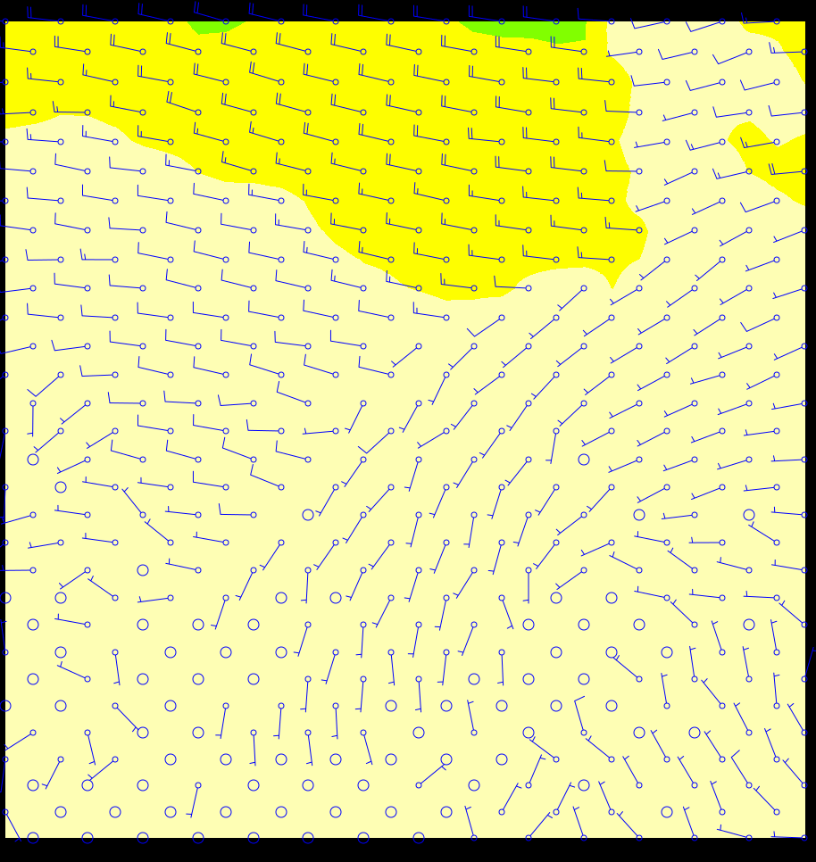
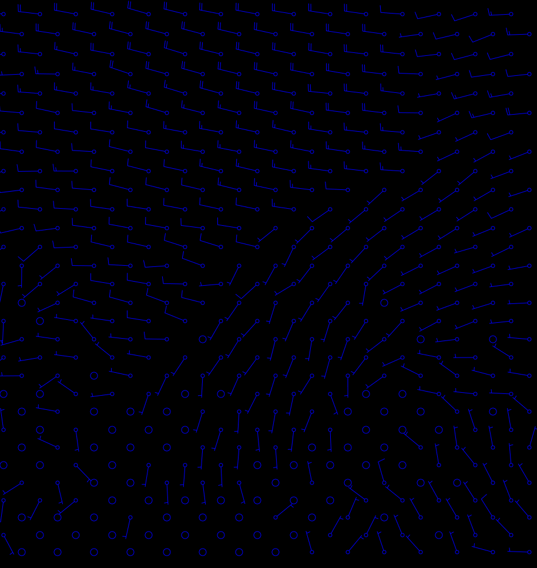

Migrating from CImgWarpBilinear to the generic warper
=======================================================

[Back to readme](./Readme.md)

`CImgWarpBilinear` — the renderer previously chosen by the `bilinear`, `shaded`,
`contour`, `vector`, `barb` and `thin` `RenderMethod` keywords — has been removed
from adaguc-server. Everything it used to draw is now drawn by the generic warper
(`CImgWarpGeneric`) together with the point renderer (`CImgRenderPoints`).

**In most cases no configuration changes are needed.** The server still recognizes
the same `RenderMethod` keywords and renders equivalent output. This tutorial
explains what changed under the hood, when you may still want to touch your
config, and how to recognize and work around the handful of known rendering
differences.

## Why this changed

`CImgWarpBilinear` was a ~1300 line, separately-maintained renderer that duplicated
logic already present in the generic warper, including a performance anti-pattern
in its contour drawing (it re-scanned the full image once per contour line
definition). The generic warper already covered the same ground through
`RenderSettings`' `interpolationmethod`/`drawgrid` attributes, `ShadeInterval`,
and `ContourLine`, so the scalar half of `CImgWarpBilinear` was redundant. Its
vector/barb half is replaced by the existing `pointsfromgrid` `DataPostProc` +
`CImgRenderPoints` pipeline, which was already used by some styles and needed no
new rendering code — see [Vector.md](../configuration/Vector.md) and
[DataPostProc.md](../configuration/DataPostProc.md).

## What changed, per RenderMethod keyword

| `RenderMethod` keyword(s)                 | Used to render with      | Now renders with                              |
|--------------------------------------------|---------------------------|------------------------------------------------|
| `bilinear`                                  | `CImgWarpBilinear`        | `CImgWarpGeneric` (generic warper)              |
| `shaded`, `contour`, and combinations like `shadedcontour`, `nearestcontour` | `CImgWarpBilinear`        | `CImgWarpGeneric` (generic warper)              |
| `vector`, `barb`, `thin`                    | `CImgWarpBilinear`        | `CImgRenderPoints`, fed by `pointsfromgrid`     |
| combinations of the above, e.g. `barbshadedcontour` | `CImgWarpBilinear` (single pass) | both of the above together, in the same render |

`nearest` on its own was never handled by `CImgWarpBilinear` — it already went
through `CImgWarpNearestNeighbour` and is unaffected by this migration.

## Scalar styles (bilinear / shaded / contour)

If your style uses only `bilinear`, `shaded` and/or `contour` (no vector/barb/thin),
there is nothing to change. The server detects these keywords and routes the style
through the generic warper automatically, reading the same `ShadeInterval` and
`ContourLine` elements it always did.

If you want explicit control over interpolation or whether the field's own colors
get painted (equivalent to `CImgWarpBilinear`'s old `drawMap`/`drawShaded` flags),
add a `RenderSettings` element — see [RenderSettings.md](../configuration/RenderSettings.md):

```xml
<RenderSettings interpolationmethod="bilinear" drawgrid="true"/>
```

Without a `RenderSettings` element, the server defaults to bilinear interpolation
and paints the field whenever `bilinear` or `shaded` is present — matching
`CImgWarpBilinear`'s old behavior, which always sampled with smooth interpolation
regardless of the `nearest`/`bilinear` keyword.

## Styles with multiple selectable RenderMethod keywords

A style can still list several `RenderMethod` keywords on one block, and a client
picks one with `STYLES=<stylename>/<keyword>`:

```xml
<Style name="my_style">
  <ShadeInterval .../>
  <ContourLine .../>
  <RenderMethod>nearest,bilinear,nearestcontour,shadedcontour</RenderMethod>
</Style>
```

`STYLES=my_style/bilinear` renders a plain colormap, `STYLES=my_style/shadedcontour`
renders the shaded classes with contour lines on top of the same `ShadeInterval`/
`ContourLine` elements. This keeps working through the generic warper: it checks
the `RM_SHADED`/`RM_CONTOUR` bits the selected keyword maps to before drawing a
style's `ShadeInterval`/`ContourLine` elements, so picking `bilinear` alone does not
also draw the shading or contours the same style block happens to define for its
other keywords.

**For new configs, prefer composing variants as separate styles with
`IncludeStyle` and `<RenderMethod>generic</RenderMethod>`, rather than one style
block selected by keyword.** Put each drawable element (palette/legend,
`ShadeInterval`, `ContourLine`) in its own includable style, then assemble each
selectable variant from only the pieces it should draw:

```xml
<Style name="my_style_palette">
  <Legend fixed="true">multicolor</Legend>
  <Min>-5</Min>
  <Max>115</Max>
</Style>

<Style name="my_style_bilinear" title="Plain colormap">
  <IncludeStyle name="my_style_palette"/>
  <RenderSettings interpolationmethod="bilinear"/>
</Style>

<Style name="my_style_bilinear_contours" title="Colormap with contour lines">
  <IncludeStyle name="my_style_bilinear"/>
  <ContourLine width="1.8" linecolor="#000000" textformatting="" interval="10"/>
</Style>
```

Neither variant needs an explicit `<RenderMethod>` tag — a style with none defaults
to `generic`, which simply draws whatever `ShadeInterval`/`ContourLine`/
`RenderSettings` elements that specific style ended up with through its own
`IncludeStyle` chain. Each variant gets its own name and title in
`GetCapabilities` instead of a `/keyword` suffix on a shared one, and there is no
keyword-matching logic involved in deciding what gets drawn. The AHN demo config
already uses exactly this pattern — see `style_colormapped_bilinear_multicolor`
and `style_colormapped_bilinear_multicolor_contours` in
[adaguc.tests.ahn_utrechtse_heuvelrug_500m.xml](../../data/config/datasets/adaguc.tests.ahn_utrechtse_heuvelrug_500m.xml).

## Vector, barb and thin-grid styles

This is the part that needs a closer look, because `CImgWarpBilinear` computed
barb/vector placement internally from the raw grid, while `CImgRenderPoints` draws
from `points` that a `pointsfromgrid` `DataPostProc` run extracts from that grid
first.

### The automatic fallback

If a `barb`, `vector` or `thin` style has no `Vector` element and the layer has no
`pointsfromgrid` `DataPostProc`, the server now synthesizes both automatically at
render time:

- a default `Vector` (`vectorstyle="barb"` or `"vector"` depending on which keyword
  matched, plain blue, no outline — the same look `CImgWarpBilinear` drew by
  default), honoring `rendertextforvectors` in `RenderSettings` the same way
  `CImgWarpBilinear` did;
- a default `Thinning radius="40"`;
- a `pointsfromgrid` run with `select="speed_component,direction_component"`,
  which requires `convert_uv_components` to already have run on the layer — the
  same requirement `CImgWarpBilinear` had, since it also needed the absolute
  eastward/northward components that `convert_uv_components` produces.

This means an old config that relied entirely on `CImgWarpBilinear`'s defaults
keeps working without edits, as long as the layer already has
`<DataPostProc algorithm="convert_uv_components"/>`.

### Migrating explicitly (recommended for anything beyond the defaults)

Writing the `Vector`, `Thinning` and `pointsfromgrid` elements out explicitly gives
you the same styling control `CImgWarpBilinear` offered, and is the only way to
style barbs/vectors per speed class or change the sampling density. Before:

```xml
<Style name="windbarbs_kts" title="Wind barbs + filled wind speed contours">
  <IncludeStyle name="wind_colors_from_kts"/>
  <ContourLine width="1" linecolor="#444444" textcolor="#444444"
               textformatting="%2.0f" classes="7,11,16,21,27,34,41,48,56,64,74,84,100,200"/>
  <RenderMethod>barbshaded,barbshadedcontour,vectorshaded,vectorshadedcontour,barb</RenderMethod>
</Style>

<Layer type="database">
  <Name>wind__at_10m</Name>
  <Variable>x_wind__at_10m</Variable>
  <Variable>y_wind__at_10m</Variable>
  <Styles>windbarbs_kts</Styles>
  <DataPostProc algorithm="convert_uv_components"/>
</Layer>
```

After:

```xml
<Style name="windbarbs_kts" title="Wind barbs + filled wind speed contours">
  <IncludeStyle name="wind_colors_from_kts"/>
  <ContourLine width="1" linecolor="#444444" textcolor="#444444"
               textformatting="%2.0f" classes="7,11,16,21,27,34,41,48,56,64,74,84,100,200"/>
  <Vector vectorstyle="barb" linecolor="#0000FF" outlinewidth="0"/>
  <Thinning radius="40"/>
  <RenderMethod>barbshaded,barbshadedcontour,vectorshaded,vectorshadedcontour,barb</RenderMethod>
</Style>

<Layer type="database">
  <Name>wind__at_10m</Name>
  <Variable>x_wind__at_10m</Variable>
  <Variable>y_wind__at_10m</Variable>
  <Styles>windbarbs_kts</Styles>
  <DataPostProc algorithm="convert_uv_components"/>
  <DataPostProc algorithm="pointsfromgrid" select="speed_component,direction_component"/>
</Layer>
```

A `barbshaded`/`barbshadedcontour` style like this one renders in two passes that
layer onto the same canvas: the `shaded`/`contour` part goes through the generic
warper over the full grid (smooth, continuous), and the `barb` part goes through
`CImgRenderPoints` over the extracted `points` — see
[test_WMSGetMapWithHarmShadedWindSpeed.png](../../tests/expectedoutputs/TestWMS/test_WMSGetMapWithHarmShadedWindSpeed.png)
for the combined result:



Notes on the new elements:

- `Vector` — see [Vector.md](../configuration/Vector.md) for every attribute. The
  `outlinewidth="0"` above matches `CImgWarpBilinear`'s old hairline look;
  `CImgRenderPoints`' own default outline is thicker (`4.5`).
- `Thinning radius="40"` — see [Thinning.md](../configuration/Thinning.md). Without
  it, `pointsfromgrid` places one point per source grid cell, which can be far
  denser than `CImgWarpBilinear`'s old destination-pixel-interval placement on
  coarse grids. `Thinning` drops points closer together than `radius` pixels on
  screen, independent of source resolution.
- `pointsfromgrid`'s `select` lists the magnitude object first and the direction
  object second — the same ordering `Vector` expects everywhere else (see
  [Vector.md](../configuration/Vector.md)). Add `a="<pixels>"` to also stride the
  *source grid* sampling itself (useful for very high-resolution grids); see the
  comments in [DataPostProc.md](../configuration/DataPostProc.md).

### Plain barb-only styles

For a style that only draws barbs (no shading/contour), the migration is just the
`Vector`/`Thinning`/`pointsfromgrid` additions above, with a plain `RenderMethod`
like `barb`:



See [adaguc.tests.harm_windbarbs.xml](../../data/config/datasets/adaguc.tests.harm_windbarbs.xml)
for the full, working example these screenshots are taken from.

## Known rendering differences

A handful of visual differences are expected and are not bugs to report:

- **Shading/contour edges are not pixel-identical.** `CImgWarpBilinear` filled
  reprojected grid cells with a gouraud-shaded quad in destination-pixel space;
  the generic warper splits each cell into two triangles and interpolates each
  one independently. For smoothly varying fields this is indistinguishable; for
  very tightly packed contour levels (many classes within a small value range)
  lines can look slightly more faceted/fragmented than before. This is a known
  limitation of the current triangle rasterizer and may be improved later.
- **Barb/vector placement density and pattern differ**, especially on coarse
  source grids. `CImgWarpBilinear` placed symbols at roughly fixed *destination
  pixel* intervals over a smoothly interpolated field; `pointsfromgrid` places one
  symbol per *source grid cell* (before `Thinning`/`a=` reduce that). On a coarse
  grid viewed over a large area this can mean noticeably fewer, differently placed
  symbols. Tune `Thinning radius` and `pointsfromgrid`'s `a=` attribute to taste.

Neither of the two differences above affects the scalar legend/shading values
themselves — only exact pixel placement and anti-aliasing. A third difference
does change scalar values:

- **`SmoothingFilter` produces different values, not just different pixels.**
  `CImgWarpBilinear`'s smoothing weighted each neighbour by inverse distance
  (`1 / (distance + 1)`, so the center pixel dominated and corners of the window
  contributed least). The generic warper's smoothing is an unweighted average of
  every valid neighbour in the window. Both are reasonable smoothing filters, but
  they are not numerically equivalent — a style combining `SmoothingFilter` with
  `bilinear`/`shaded`/`contour` can shift legend-color boundaries and contour-line
  placement by a small amount, not just affect edge pixels.

## Verifying a migrated style

Request the style before and after your config change and compare visually (the
server has no tolerance built in — any pixel difference is expected to be small
and edge-concentrated per the notes above, not a missing layer or wrong colors).
If barbs are missing entirely after migrating, check the adaguc-server log for
`pointsfromgrid` and `Vector plotting N elements` debug lines — `N` elements means
`N` points survived thinning and were handed to the vector renderer; `0` usually
means `convert_uv_components` hasn't produced `speed_component`/
`direction_component` on that layer, or the requested bbox doesn't overlap any
source grid cells.

## Reference

- [RenderMethod.md](../configuration/RenderMethod.md)
- [Vector.md](../configuration/Vector.md)
- [Thinning.md](../configuration/Thinning.md)
- [DataPostProc.md](../configuration/DataPostProc.md)
- [RenderSettings.md](../configuration/RenderSettings.md)
- [ShadeInterval.md](../configuration/ShadeInterval.md)
- [ContourLine.md](../configuration/ContourLine.md)
