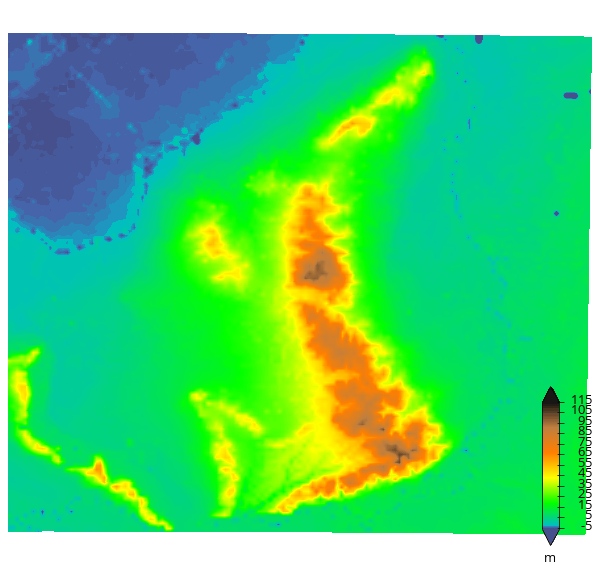
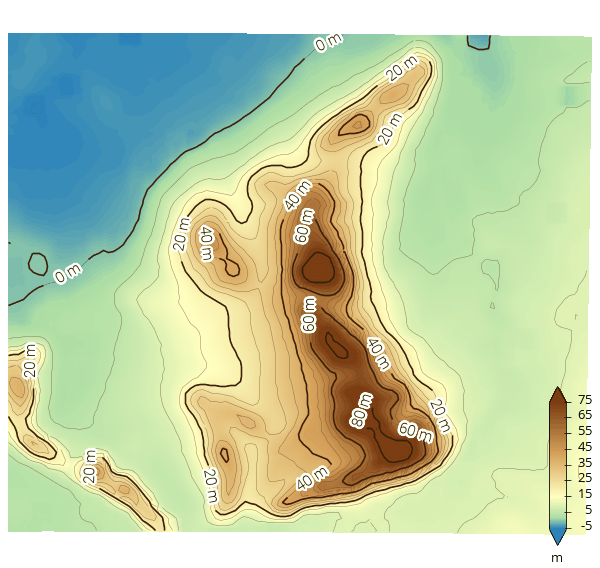
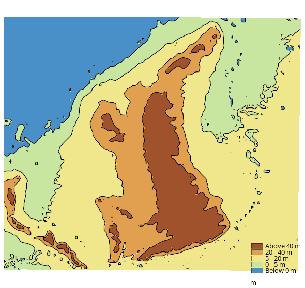
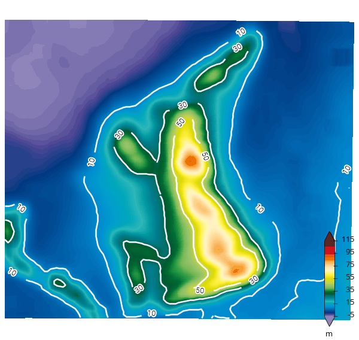
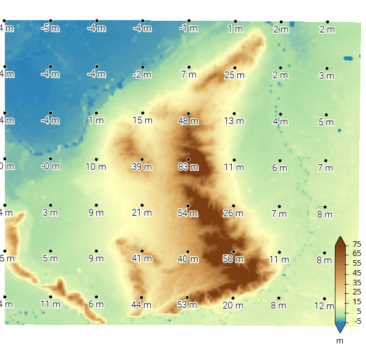

Post a custom style with STYLESHEET
===================================

[Back to readme](./Readme.md)

A WMS client can send its own `<Style>` with a GetMap request in the `STYLESHEET` parameter. The server draws the layer with that style instead of a configured one, for that request only. Nothing is stored on the server, and other users keep seeing the configured styles.

This tutorial uses the elevation map of the Utrechtse Heuvelrug that comes with this repository ([ahn_utrechtse_heuvelrug_500m.nc](../../data/datasets/ahn_utrechtse_heuvelrug_500m.nc)) and its dataset configuration ([adaguc.tests.ahn_utrechtse_heuvelrug_500m.xml](../../data/config/datasets/adaguc.tests.ahn_utrechtse_heuvelrug_500m.xml)). All style files and images are in [data/STYLESHEET](./data/STYLESHEET/).

The images in this tutorial were made with the commands shown.

## 1. Enable STYLESHEET on the server

`STYLESHEET` is disabled by default. Enable it with the environment variable `ADAGUC_STYLESHEET_ENABLE=TRUE`:

- Docker compose: add `- "ADAGUC_STYLESHEET_ENABLE=TRUE"` to the `environment` list of the `adaguc-server` service in [docker-compose.yml](../../Docker/docker-compose.yml) and restart.
- Local development server (see [Developing](../Developing.md)): `export ADAGUC_STYLESHEET_ENABLE=TRUE` before `python3 ./python/python_fastapi_server/main.py`.

Without it, a request with `STYLESHEET` is refused with status 422 and `STYLESHEET is not enabled`.

## 2. Add the elevation dataset

Copy the dataset configuration into your dataset directory and scan it:

```bash
cp data/config/datasets/adaguc.tests.ahn_utrechtse_heuvelrug_500m.xml ${ADAGUC_DATASET_DIR}/ahn_utrechtse_heuvelrug.xml

# Docker:
docker exec -i -t my-adaguc-server scan.sh -d ahn_utrechtse_heuvelrug
# Local development server:
bash scripts/scan.sh -d ahn_utrechtse_heuvelrug
```

The configuration points to `{ADAGUC_PATH}/data/datasets/ahn_utrechtse_heuvelrug_500m.nc`, which is also in the Docker image.

The commands below use these two shell variables. With Docker, use `https://localhost` instead and add `-k` to curl for the self-signed certificate.

```bash
WMS="http://localhost:8080/wms?DATASET=ahn_utrechtse_heuvelrug"
MAP="SERVICE=WMS&VERSION=1.3.0&REQUEST=GetMap&LAYERS=ahn_utrechtseheuvelrug_500m&CRS=EPSG:3857&BBOX=590360,6784100,707370,6894820&WIDTH=600&HEIGHT=568&FORMAT=image/png&SHOWLEGEND=true"
```

## 3. The configured style

A normal GET request with one of the configured styles:

```bash
curl -o 01_configured_style.png "$WMS&$MAP&STYLES=style_colormapped_bilinear_elevation"
```



## 4. Post your own colours

[style_terrain.xml](./data/STYLESHEET/style_terrain.xml) defines a `Legend` (the colour palette) and a `Style` that uses it, with its own range:

```xml
<Legend name="terrain" type="colorRange">
  <palette index="0"   color="#2B83BA"/>
  <palette index="20"  color="#ABDDA4"/>
  <palette index="60"  color="#FFFFBF"/>
  <palette index="140" color="#D7A35B"/>
  <palette index="240" color="#7A3B10"/>
</Legend>
<Style name="terrain">
  <Legend fixedclasses="true" tickinterval="10">terrain</Legend>
  <Min>-5</Min>
  <Max>75</Max>
  <RenderSettings interpolationmethod="bilinear"/>
</Style>
```

Post it as a form url encoded parameter. `--data` sends the normal WMS parameters and `--data-urlencode` encodes the file contents:

```bash
curl -o 02_terrain.png "$WMS" --data "$MAP" --data-urlencode "STYLESHEET@style_terrain.xml"
```


Points to note:

- The posted style is used whatever `STYLES` is set to, and its name does not matter. You can leave `STYLES` out.
- A posted `Legend` replaces a configured legend with the same name, for this request only.
- The XML can be a bare list of `Legend` and `Style` elements, or wrapped in `<Configuration>`. An `<?xml ...?>` declaration is allowed.
- The layer's legend (here drawn in the map with `SHOWLEGEND=true`) follows the posted style. `REQUEST=GetLegendGraphic` accepts `STYLESHEET` as well.

## 5. Contour lines with labels

[style_terrain_contours.xml](./data/STYLESHEET/style_terrain_contours.xml) adds smoothing and two sets of contour lines: thin lines every 5 m and labelled lines every 20 m.

```xml
<Style name="terrain_contours">
  <Legend fixedclasses="true" tickinterval="10">terrain</Legend>
  <Min>-5</Min>
  <Max>75</Max>
  <RenderSettings interpolationmethod="bilinear"/>
  <SmoothingFilter>2</SmoothingFilter>
  <ContourLine width="0.6" linecolor="#5A3A1A80" interval="5"/>
  <ContourLine width="1.6" linecolor="#3A2008" textcolor="#3A2008" textstrokecolor="#FFFFFFC0" textstrokewidth="3" textsize="11" textformatting="%.0f m" interval="20"/>
</Style>
```

(The file also contains the `terrain` legend from step 4.)

```bash
curl -o 03_terrain_contours.png "$WMS" --data "$MAP" --data-urlencode "STYLESHEET@style_terrain_contours.xml"
```



## 6. Discrete classes

[style_classes.xml](./data/STYLESHEET/style_classes.xml) uses `ShadeInterval` elements. Their labels appear in the legend:

```xml
<Style name="classes">
  <ShadeInterval min="-100" max="0"   label="Below 0 m"       fillcolor="#4A90C8"/>
  <ShadeInterval min="0"    max="5"   label="0 - 5 m"         fillcolor="#C8E6A0"/>
  <ShadeInterval min="5"    max="20"  label="5 - 20 m"        fillcolor="#F0E68C"/>
  <ShadeInterval min="20"   max="40"  label="20 - 40 m"       fillcolor="#E0A050"/>
  <ShadeInterval min="40"   max="200" label="Above 40 m"      fillcolor="#A0522D"/>
  <RenderSettings interpolationmethod="bilinear"/>
  <ContourLine width="1.2" linecolor="#000000" classes="0,5,20,40"/>
</Style>
```

```bash
curl -o 04_classes.png "$WMS" --data "$MAP" --data-urlencode "STYLESHEET@style_classes.xml"
```



## 7. Build on a configured style

`IncludeStyle` reuses a style from the server configuration. The posted elements are added to it. [style_include.xml](./data/STYLESHEET/style_include.xml) takes the configured `style_colormapped_bilinear_multicolor`, uses fewer legend ticks and adds white contour lines at 10, 30 and 50 m:

```xml
<Style name="multicolor_with_my_contours">
  <IncludeStyle name="style_colormapped_bilinear_multicolor"/>
  <Legend tickinterval="20">multicolor</Legend>
  <SmoothingFilter>3</SmoothingFilter>
  <ContourLine width="2.5" linecolor="#FFFFFF" textcolor="#000000" textstrokecolor="#FFFFFF" textstrokewidth="2" textformatting="%.0f" classes="10,30,50"/>
</Style>
```

```bash
curl -o 05_include.png "$WMS" --data "$MAP" --data-urlencode "STYLESHEET@style_include.xml"
```



`IncludeStyle` can only name styles that are configured on the server.

## 8. Values as points

The `pointsfromgrid` DataPostProc samples the grid at regular distances (`a`, in pixels). A `Point` element draws the values as text. [style_spotheights.xml](./data/STYLESHEET/style_spotheights.xml) puts them on the terrain colours from step 4:

```xml
<Style name="terrain_spot_heights">
  <Legend fixedclasses="true" tickinterval="10">terrain</Legend>
  <Min>-5</Min>
  <Max>75</Max>
  <RenderSettings interpolationmethod="bilinear"/>
  <DataPostProc algorithm="pointsfromgrid" a="75" select="depth"/>
  <Point pointstyle="point" discradius="3" fillcolor="#000000" linecolor="#FFFFFF" textcolor="#000000" textoutlinecolor="#FFFFFF" textradius="12" fontsize="11" textformat="%.0f m"/>
</Style>
```

```bash
curl -o 06_spot_heights.png "$WMS" --data "$MAP" --data-urlencode "STYLESHEET@style_spotheights.xml"
```



`SymbolInterval` can draw `.png` symbols instead. The files must be in `{ADAGUC_PATH}data/symbols`, `{ADAGUC_PATH}data/resources` or `{ADAGUC_DATASET_DIR}` (or a subdirectory), for example `<SymbolInterval file="{ADAGUC_PATH}data/resources/icons/helicopter.png"/>`.

## 9. From Python and JavaScript

Python, with `requests`:

```python
import requests

with open("style_terrain.xml", encoding="utf-8") as f:
    stylesheet = f.read()

params = {
    "DATASET": "ahn_utrechtse_heuvelrug",
    "SERVICE": "WMS", "VERSION": "1.3.0", "REQUEST": "GetMap",
    "LAYERS": "ahn_utrechtseheuvelrug_500m",
    "CRS": "EPSG:3857", "BBOX": "590360,6784100,707370,6894820",
    "WIDTH": 600, "HEIGHT": 568, "FORMAT": "image/png",
    "STYLESHEET": stylesheet,
}
response = requests.post("http://localhost:8080/wms", data=params, timeout=60)
response.raise_for_status()
with open("terrain.png", "wb") as f:
    f.write(response.content)
```

JavaScript in a browser. `URLSearchParams` as body sends the parameters form url encoded. Show the image with an object URL:

```javascript
const params = new URLSearchParams({
  DATASET: "ahn_utrechtse_heuvelrug",
  SERVICE: "WMS", VERSION: "1.3.0", REQUEST: "GetMap",
  LAYERS: "ahn_utrechtseheuvelrug_500m",
  CRS: "EPSG:3857", BBOX: "590360,6784100,707370,6894820",
  WIDTH: "600", HEIGHT: "568", FORMAT: "image/png",
  STYLESHEET: stylesheetXml, // e.g. the contents of a textarea
});
const response = await fetch("http://localhost:8080/wms", { method: "POST", body: params });
if (!response.ok) throw new Error(await response.text()); // 422 explains what is wrong
document.getElementById("map").src = URL.createObjectURL(await response.blob());
```

`STYLESHEET` also works in a GET query string, but POST avoids URL length limits.

## 10. What can be posted

The XML is checked against an allowlist before it is used. See [StyleSheetValidation.cpp](../../adagucserverEC/utils/StyleSheetValidation.cpp) for the full list.

- Allowed: `Legend` with `palette`, and one `Style` with the usual styling elements: `Min`, `Max`, `ShadeInterval`, `ContourLine`, `SmoothingFilter`, `RenderSettings`, `RenderMethod`, `Point`, `Vector`, `Thinning`, `SymbolInterval`, `FeatureInterval`, `Stippling`, `IncludeStyle`, and so on.
- Values are typed and bounded: colours must be `#RRGGBB` or `#RRGGBBAA`, numbers must be finite and within a range (for example `SmoothingFilter` 0 to 20, palette indices 0 to 255), and class lists must be numbers.
- Not allowed: other elements such as `Layer`, font files, any file except the `.png` symbols above, `labelpropertyformat`, DOCTYPEs, and `DataPostProc` other than `pointsfromgrid`, `beaufort` and `clipminmax`.
- printf formats such as `textformatting="%.1f"` are accepted. A format that is not a single float conversion (for example `%s`) is printed with `%g` instead.
- Only one layer per request, and at most one `Style`.

The server answers with:

| Status | Reason |
|---|---|
| 422 | `STYLESHEET` is not enabled, the XML is invalid or not allowed, or more than one layer is requested. The body says why, for example `STYLESHEET: invalid value for attribute [linecolor] in [ContourLine]`. |
| 413 | The POST body, or the parameters after url encoding, are larger than 64 KB. Encoding makes characters like `<`, `>`, `"` and spaces three bytes, so keep a stylesheet below about 20 KB. |
| 415 | The POST body is not `application/x-www-form-urlencoded`. |

## 11. Notes for server administrators

- POST responses are not stored in the Redis response cache (`ADAGUC_REDIS`). Only GET requests are cached.
- A valid style can still be expensive to render. Put a rate or concurrency limit in front of a public server, see [Environment variables](../EnvironmentVariablesAndExitCodes.md).
- `adagucserver --lint` checks the configured styles with the same value rules.
