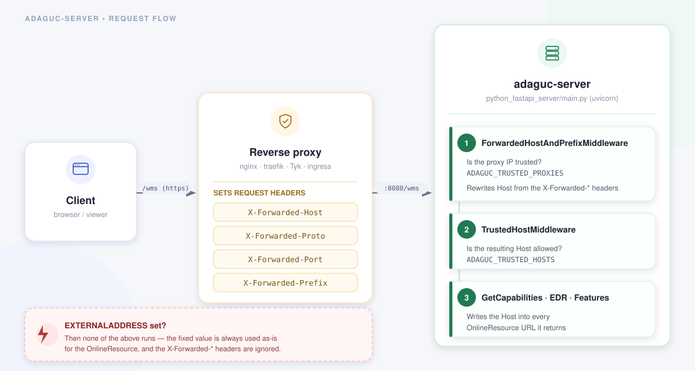

Running adaguc-server behind a reverse proxy
=============================================

[Back to tutorials](./Readme.md)

When adaguc-server sits behind a reverse proxy (nginx, traefik, Tyk, an ingress controller, a load
balancer), the server itself only ever sees the *internal* address it is reached on, for example
`http://adaguc-server:8080/wms`. If it used that address to build the `OnlineResource` links in its
`GetCapabilities` document, clients outside the proxy would get back URLs they cannot reach.

adaguc-server solves this by constructing its external address either from a fixed
`EXTERNALADDRESS` environment variable, or dynamically from the `X-Forwarded-Host`,
`X-Forwarded-Proto`, `X-Forwarded-Port` and `X-Forwarded-Prefix` request headers set by a trusted
proxy. This tutorial shows how to configure both approaches, using the nginx configuration shipped
in this repository's `Docker/nginx-adaguc/nginx.conf` as a concrete example.

This applies to the Python/FastAPI front end (`python/python_fastapi_server/main.py`), which is
what the official Docker image runs and what is described below. It does not apply when calling the
`adagucserver` C++ binary directly as a bare CGI program, which has no notion of these headers.

Why this matters
-----------------



A client's request passes through the reverse proxy, which adds the `X-Forwarded-*` headers
describing the address the client actually used, before forwarding the request on to
adaguc-server's internal address. adaguc-server then uses those headers, if the proxy is trusted,
to rewrite the effective `Host` of the request before anything else runs — so every part of the
server that reports a URL back to the client (`GetCapabilities`, `GetLegendGraphic`, the OGC API
EDR and Features endpoints) ends up using the externally reachable address, not the internal one.

Two ways to set the external address
--------------------------------------

### 1. A fixed `EXTERNALADDRESS`

Set this when the service is only ever reachable at one, known public URL:

```sh
export EXTERNALADDRESS="https://maps.example.com/adaguc-server/"
```

This value is always used as-is for the `OnlineResource`, including its path prefix. When
`EXTERNALADDRESS` is set, adaguc-server does not look at `X-Forwarded-*` headers or the `Host`
header at all — the two mechanisms are mutually exclusive, and `EXTERNALADDRESS` always wins.

### 2. Dynamic detection from `X-Forwarded-*` headers

Leave `EXTERNALADDRESS` unset and instead let the proxy tell adaguc-server, per request, what
address it should use. This is the right choice when the same adaguc-server instance is reachable
under several hostnames or path prefixes (for example a shared instance behind an ingress
controller with per-tenant routing), since a single fixed `EXTERNALADDRESS` could not cover that.

Configure two environment variables on adaguc-server:

| Variable | Purpose | Default |
|---|---|---|
| `ADAGUC_TRUSTED_PROXIES` | Which proxy IP addresses are allowed to set the `X-Forwarded-*` headers. Requests from any other address keep their own `Host` header unmodified. | `127.0.0.1` |
| `ADAGUC_TRUSTED_HOSTS` | Which resulting hostnames are allowed to be used as `OnlineResource`. A request that resolves to a host outside this list is rejected with `400 Invalid host header`. Use `*` to allow any. | unset (`*`, i.e. not checked) |

```sh
export ADAGUC_TRUSTED_PROXIES="10.0.0.0/8"
export ADAGUC_TRUSTED_HOSTS="maps.example.com"
```

Both are comma-separated lists, so you can trust several proxies or several public hostnames at
once. See [EnvironmentVariablesAndExitCodes.md](../EnvironmentVariablesAndExitCodes.md) for the
full reference of every environment variable, including these two.

Configuring the reverse proxy
------------------------------

The proxy must set the forwarded headers on every request it passes on to adaguc-server. The
nginx configuration shipped with this project's own Docker setup
([Docker/nginx-adaguc/nginx.conf](../../Docker/nginx-adaguc/nginx.conf)) does exactly this for its
HTTPS server block:

```nginx
location /adaguc-server {
    proxy_set_header X-Forwarded-Host  $host;
    proxy_set_header x-forwarded-port  $server_port;
    proxy_set_header x-forwarded-proto https;
    proxy_pass http://adaguc-server:8080/wms;
}
```

Header names are case-insensitive, so `X-Forwarded-Host` and `x-forwarded-host` are equivalent.
`$server_port` here is nginx's own listening port (443 for the HTTPS block), which is what a
client outside the proxy actually connects to — not whatever port adaguc-server listens on
internally. There is no need to set `X-Forwarded-Prefix` unless the proxy also rewrites the
request path, for example strips or adds a path segment before forwarding.

An equivalent traefik label would be:

```yaml
labels:
  - "traefik.http.middlewares.adaguc-headers.headers.customrequestheaders.X-Forwarded-Host=maps.example.com"
  - "traefik.http.middlewares.adaguc-headers.headers.customrequestheaders.X-Forwarded-Proto=https"
```

though in practice traefik and most ingress controllers already set `X-Forwarded-*` headers
correctly by default, based on the request it actually received — you mainly need to configure
`ADAGUC_TRUSTED_PROXIES`/`ADAGUC_TRUSTED_HOSTS` on the adaguc-server side to trust them.

Worked example
---------------

Given this request arriving at adaguc-server, with its connecting IP address included in
`ADAGUC_TRUSTED_PROXIES` and `maps.example.com` included in `ADAGUC_TRUSTED_HOSTS`:

```
GET /adaguc-server?service=WMS&request=GetCapabilities HTTP/1.1
Host: adaguc-server:8080
X-Forwarded-Host: maps.example.com
X-Forwarded-Proto: https
X-Forwarded-Port: 443
```

The resulting `OnlineResource` in the `GetCapabilities` response is:

```xml
<OnlineResource xlink:type="simple" xlink:href="https://maps.example.com/adaguc-server?SERVICE=WMS&amp;"/>
```

Note that the `443` port is omitted because it is the default port for `https`; the same applies
to port `80` with `http`. If `X-Forwarded-Prefix` is also set, for example to `/geo`, it is
inserted right after the host: `https://maps.example.com/geo/adaguc-server?...`.

The `/healthcheck` endpoint always responds regardless of `ADAGUC_TRUSTED_HOSTS`, so a load
balancer's health check keeps working even for a hostname that is not (yet) in the trusted list.

Verifying it works
--------------------

Once deployed, request `GetCapabilities` through the proxy exactly as a client would, and check the
`OnlineResource` value in the response:

```sh
curl -s "https://maps.example.com/adaguc-server?service=WMS&request=getcapabilities" \
  | grep -o '<OnlineResource[^/]*/>'
```

It should show `https://maps.example.com/adaguc-server?...`, not the internal address or port
adaguc-server actually listens on.

To test the header handling directly against adaguc-server itself, without a real proxy in front,
send the headers manually (this is effectively what
[test_behind_proxy.py](../../python/python_fastapi_server/test_behind_proxy.py) does in the test
suite):

```sh
curl -s "http://localhost:8080/adaguc-server?service=WMS&request=getcapabilities" \
  -H "X-Forwarded-Host: maps.example.com" \
  -H "X-Forwarded-Proto: https" \
  -H "X-Forwarded-Port: 443" \
  | grep -o '<OnlineResource[^/]*/>'
```

This only has an effect if the machine you run `curl` from is itself in `ADAGUC_TRUSTED_PROXIES` —
otherwise adaguc-server ignores the headers, which is the correct, secure behavior: an untrusted
client must never be able to set its own `X-Forwarded-Host` and have the server believe it.

Troubleshooting
-----------------

- **`OnlineResource` still shows the internal address or port.** The connecting proxy's IP address
  is not in `ADAGUC_TRUSTED_PROXIES`. Inside Docker/Kubernetes networks this is often a container
  or pod IP, not `127.0.0.1` — check the actual source IP adaguc-server sees (log it, or
  temporarily set `ADAGUC_TRUSTED_PROXIES=*` to confirm this is the cause before narrowing it back
  down).
- **`400 Invalid host header`.** The resulting hostname (the rewritten `X-Forwarded-Host`, or the
  `EXTERNALADDRESS`'s own host if you also set `ADAGUC_TRUSTED_HOSTS`) is not in
  `ADAGUC_TRUSTED_HOSTS`. Add it, or use `*` while testing.
- **Changing `EXTERNALADDRESS` or the proxy headers has no effect.** `EXTERNALADDRESS` always wins
  outright over the headers; unset it if you want the dynamic, header-based behavior instead.

See also [Running.md](../Running.md) for the general Docker setup, and
[EnvironmentVariablesAndExitCodes.md](../EnvironmentVariablesAndExitCodes.md) for every environment
variable adaguc-server reads.
